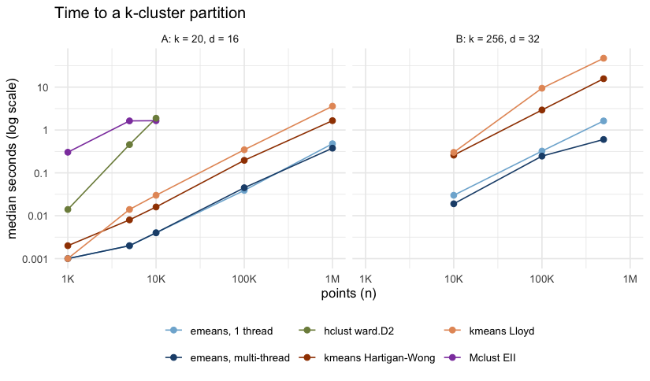

# emeansR 

<!-- badges: start -->
[](https://github.com/ToledoEM/emeansR/actions/workflows/R-CMD-check.yaml)
[](https://github.com/ToledoEM/emeansR/actions/workflows/test-coverage.yaml)
[](https://github.com/ToledoEM/emeansR/actions/workflows/pkgdown.yaml)
[](https://github.com/ToledoEM/emeansR/blob/main/LICENSE)
[](https://lifecycle.r-lib.org/articles/stages.html#experimental)
<!-- badges: end -->

An R implementation of e-means (Bessa et al., 2026, [arXiv:2611.09501](https://arxiv.org/abs/2611.09501)), a mini-batch replacement for Lloyd's k-means. Each centroid follows an exponential moving average of its mini-batch means, and fitted scaling laws set the batch size and step size, so you only supply the data, `k` and an epoch budget. The paper reports a lower within-cluster sum of squares than 25 Lloyd iterations after a few epochs; the benchmark below shows where that holds.

The compute core (nearest-centroid assignment and the EMA updates) is Rust, multi-threaded on the CPU. The training recipe follows the reference library, [`faiss/contrib/e_means`](https://github.com/facebookresearch/faiss/tree/main/contrib/e_means), and gives the same batch size and step size for the same `n`, `k`, `d` and epoch budget.

## Installation

You need a Rust toolchain (`rustc` >= 1.71 and `cargo`): `apt-get install cargo rustc`, `dnf install cargo`, `brew install rust`, or [rustup](https://rustup.rs/). All Rust dependencies ship with the package, so the build needs no network access.

```r
# install.packages("remotes")
remotes::install_github("ToledoEM/emeansR")
```

## Example

```r
library(emeansR)

set.seed(1)
centers <- matrix(rnorm(256 * 32, sd = 3), 256)
x <- centers[sample(256, 1e5, TRUE), ] + matrix(rnorm(1e5 * 32), 1e5)

fit <- emeans(x, k = 256, nepochs = 3)
fit$tot.withinss / nrow(x)    # mean squared distance to the nearest center
predict(fit, x[1:5, ])        # cluster labels for new rows
```

`emeans()` returns an object that also inherits from `kmeans`, with the usual `cluster`, `centers`, `size`, `withinss` and `tot.withinss` components.

On an Apple M2 (7 threads), this example took 0.20 s with a loss of 54.7. `stats::kmeans(algorithm = "Lloyd", iter.max = 25)` from random rows took 9.3 s and reached 64.5.

Other features:

- `spherical = TRUE` clusters unit vectors by cosine similarity.
- `precision = "single"` computes distances in float32.
- `max_points_per_centroid` trains on a random subset, as `faiss.Kmeans` does.
- `emeans_stream()` and its companions train on data supplied in chunks, for data that does not fit in memory.
- `emeans_recipe()` shows the batch size and step size the scaling laws pick.

## Benchmark

Median time to a `k`-cluster partition for `emeans()`, `kmeans()`, `hclust()` and `Mclust()` on two synthetic scenarios (5 seeds each, Apple M2). `hclust()` and `Mclust()` stop at n = 10,000 because their memory grows with n².



With 256 clusters, `emeans()` is 12 to 26 times faster than `kmeans()` (26 times at n = 500,000) at similar quality. With 20 well-separated clusters it is the fastest method, but `hclust()` and `Mclust()` find better partitions. The [benchmark article](https://toledoem.github.io/emeansR/articles/benchmark.html) has the quality results and caveats.

## Citation

```r
citation("emeansR")
```

Bessa S, Mazaré P-E, Szilvasy G, Touvron H, Picard D, Douze M, Jégou H (2026). e-means: outperforming k-means (in one-tenth the epochs). arXiv:2611.09501.

## License

MIT. `inst/AUTHORS` lists the bundled Rust crates with their authors and licenses.

## Logo

The emeansR logo was made with ChatGPT.
