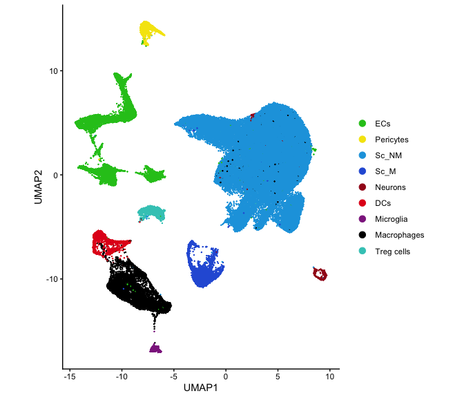
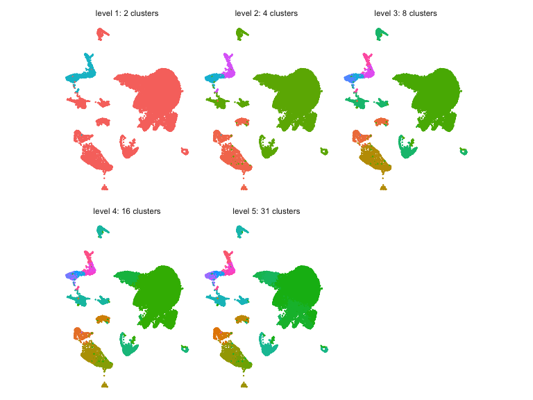
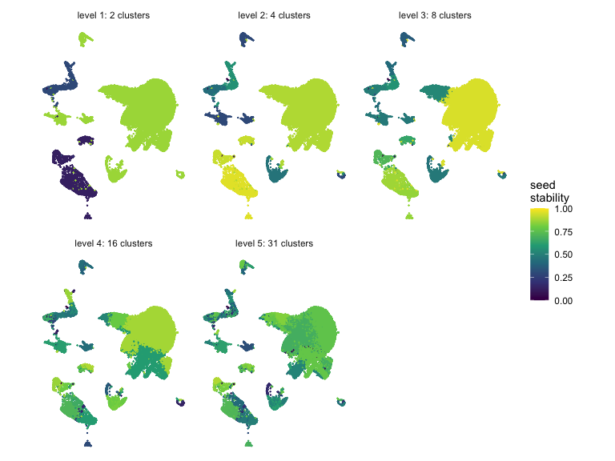
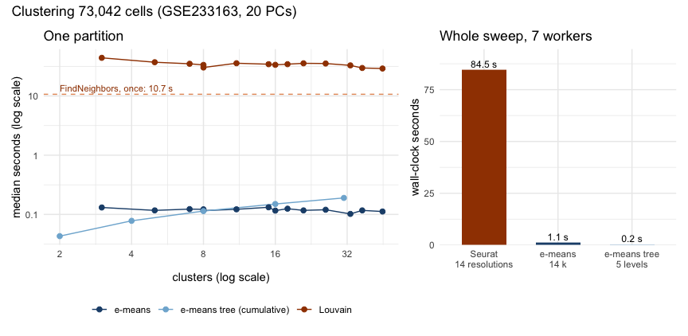

# A resolution tree for single-cell data

In most single-cell datasets there is no right number of clusters, so
the analysis looks for several resolutions and keep the ones that hold
up, in data and biology. This article builds that view with
[`emeans()`](https://toledoem.github.io/emeansR/reference/emeans.md): it
splits the cells in two, splits each half in two again, and so on, which
gives a dendrogram whose depths are increasing resolutions. Reruns with
other seeds show which branches are stable, and Seurat’s Louvain
clustering at matching cluster counts serves as an outside reference.

The data are GEO series
[GSE233163](https://www.ncbi.nlm.nih.gov/geo/query/acc.cgi?acc=GSE233163):
about 73,000 mouse cells from two tissues, at baseline and under obesity
(Sarker et al., 2026). The authors distribute a Seurat object and a
separate cell metadata table with their cell-type labels. Neither file
ships with the package, and building the site does not re-run this
article.

``` r

library(emeansR)
library(Seurat)
library(mclust)
library(dplyr)
library(tidyr)
library(purrr)
library(tibble)
library(ggplot2)
library(patchwork)
library(tidygraph)
library(ggraph)
```

## Setup

- Machine: Apple M2, 8 physical cores; R version 4.6.1 (2026-06-24).
- Packages: emeansR 0.1.0, Seurat 6.0.0.
- [`emeans()`](https://toledoem.github.io/emeansR/reference/emeans.md)
  runs on 7 threads.

A separate script ran the slow steps (embedding, trees, reruns,
stability, Louvain) once and saved every result to disk. The chunks
below show the code, and the article reads the saved results.

Extract the GEO file once, then
[`readRDS()`](https://rdrr.io/r/base/readRDS.html) reads it. The object
(Seurat 3.1 format, 8.7 GB in memory) has the authors’ integrated
expression but not their PCA or UMAP. The code below keeps only the
integrated assay: 3,000 genes, 2,000 of them the variable features used
for integration.

``` r

system("gunzip -k .dev/data/GSE233163_seurat_object.rds.gz")
full <- readRDS(".dev/data/GSE233163_seurat_object.rds")
integrated <- full@assays$integrated
obj <- CreateSeuratObject(CreateAssay5Object(data = integrated@data), assay = "integrated")
VariableFeatures(obj) <- integrated@var.features
rm(full, integrated)
invisible(gc())
```

PCA and UMAP use the settings recorded in the object’s command log: 30
components, then UMAP on the first 20 with cosine distance, 30
neighbours and `min.dist = 0.3`. Clustering runs on the same 20
components.

``` r

embedding <- local({
  obj <- ScaleData(obj, verbose = FALSE)
  obj <- RunPCA(obj, npcs = 30, seed.use = 12345, verbose = FALSE)
  obj <- RunUMAP(obj, dims = 1:20, n.neighbors = 30, metric = "cosine", min.dist = 0.3,
                 seed.use = 12345, verbose = FALSE)
  list(pcs = Embeddings(obj, "pca")[, 1:20], umap = Embeddings(obj, "umap"))
})
rm(obj)
```

``` r

pcs <- embedding$pcs
umap <- embedding$umap
dim(pcs)
#> [1] 73042    20

meta <- read.csv(".dev/data/GSE233163_cells_metadata.csv.gz")
cell_type <- meta$cell_type[match(rownames(pcs), meta$id)]
```

The metadata has 12 cell-type labels. The article groups them into the 9
cell types of Sarker et al. (2026), Fig. 1b, and uses that figure’s
colours.

``` r

cell_group_map <- c(
  endothelial_1 = "ECs", endothelial_2 = "ECs", endothelial_3 = "ECs",
  pericyte = "Pericytes",
  schwann_cell_1 = "Sc_NM", schwann_cell_2 = "Sc_NM",
  schwann_cell_myelinating = "Sc_M",
  neuron = "Neurons",
  dendritic = "DCs",
  microglia_1 = "Microglia",
  macrophage = "Macrophages",
  t_reg_lymphocyte = "Treg cells"
)
cell_group_colours <- c(
  ECs = "#22C41E", Pericytes = "#F5E50A", Sc_NM = "#1AA3E0", Sc_M = "#2B5FD9", Neurons = "#A3171D",
  DCs = "#E3191C", Microglia = "#8E2A8E", Macrophages = "#000000", `Treg cells` = "#3CC9C0"
)
cell_group <- factor(cell_group_map[cell_type], levels = names(cell_group_colours))
table(cell_group, useNA = "ifany")
#> cell_group
#>         ECs   Pericytes       Sc_NM        Sc_M     Neurons         DCs 
#>        7731        1501       50080        3991         406        1707 
#>   Microglia Macrophages  Treg cells 
#>         470        5886        1270
```

## Recursive bisection

Each level of the tree refines the one above it, so the resolutions
nest: every cluster at level 4 lies inside one cluster at level 3.
Louvain at separate resolutions gives no such guarantee. Each split asks
[`emeans()`](https://toledoem.github.io/emeansR/reference/emeans.md) for
two clusters, so nobody has to pick a global number of clusters in
advance. The fits are small (`nepochs = 3`), which keeps a whole tree
cheap, and every node gets its own seed, so the same seed always gives
the same tree.

`bisect_tree()` keeps one label per cell and depth. At each depth,
[`emeans()`](https://toledoem.github.io/emeansR/reference/emeans.md)
splits every node with at least `min_cells` cells in two, using only
that node’s cells; smaller nodes keep their label. A label is the path
from the root, so `"1.2.1"` is the first child of the second child of
the root.

``` r

bisect_tree <- function(x, max_depth = 5, min_cells = 200, seed = 1) {
  labels <- matrix("1", nrow(x), max_depth + 1, dimnames = list(NULL, paste0("level_", 0:max_depth)))
  for (depth in seq_len(max_depth)) {
    parent <- labels[, depth]
    child <- parent
    nodes <- unique(parent)
    for (i in seq_along(nodes)) {
      idx <- which(parent == nodes[i])
      if (length(idx) < min_cells) next
      fit <- emeans(x[idx, , drop = FALSE], 2, nepochs = 3, seed = seed * 1000 + depth * 100 + i)
      child[idx] <- paste0(nodes[i], ".", fit$cluster)
    }
    labels[, depth + 1] <- child
  }
  labels
}

max_depth <- 5
```

``` r

tree_time <- system.time(tree <- bisect_tree(pcs, max_depth))[["elapsed"]]
```

``` r

levels <- 1:max_depth
n_clusters <- map_int(levels, ~ n_distinct(tree[, .x + 1]))
tibble(level = levels, clusters = n_clusters)
#> # A tibble: 5 × 2
#>   level clusters
#>   <int>    <int>
#> 1     1        2
#> 2     2        4
#> 3     3        8
#> 4     4       16
#> 5     5       31
```

## Stability across seeds

The tree is rebuilt with ten more seeds. Cluster names are arbitrary, so
the comparison uses measures that ignore labels: the adjusted Rand index
(ARI) per level, and for each cell the Jaccard overlap between its
cluster in the reference tree and its cluster in the rerun.

``` r

reruns <- map(2:11, ~ bisect_tree(pcs, max_depth, seed = .x))
```

``` r

cell_jaccard <- function(a, b) {
  tab <- table(a, b)
  jac <- tab / (outer(rowSums(tab), colSums(tab), "+") - tab)
  jac[cbind(match(a, rownames(tab)), match(b, colnames(tab)))]
}

seed_ari <- map_dfr(seq_along(reruns), function(r) {
  tibble(run = r, level = levels,
         ari = map_dbl(levels, ~ adjustedRandIndex(tree[, .x + 1], reruns[[r]][, .x + 1])))
})

stability <- map(levels, function(l) {
  rowMeans(sapply(reruns, function(run) cell_jaccard(tree[, l + 1], run[, l + 1])))
})
```

## Louvain at matching resolutions

Seurat’s `FindClusters()` runs over a range of resolutions on a shared
nearest neighbour graph of the same 20 components (`k.param = 20`, as
the authors used). Each tree level is paired with the resolution whose
cluster count is closest to its own.

``` r

resolutions <- c(0.001, 0.002, 0.005, 0.01, 0.02, 0.05, 0.1, 0.2, 0.3, 0.5, 0.75, 1, 1.5, 2)
louvain_time <- system.time({
  graphs <- FindNeighbors(pcs, k.param = 20, verbose = FALSE)
  louvain <- FindClusters(graphs$snn, resolution = resolutions, verbose = FALSE)
})[["elapsed"]]
```

``` r

louvain_k <- map_int(louvain, n_distinct)
match_res <- map_int(n_clusters, ~ which.min(abs(louvain_k - .x)))

agreement <- tibble(
  level = levels,
  clusters = n_clusters,
  resolution = resolutions[match_res],
  louvain_clusters = louvain_k[match_res],
  ari_louvain = map2_dbl(levels, match_res, ~ adjustedRandIndex(tree[, .x + 1], louvain[[.y]])),
  ari_cell_group = map_dbl(levels, ~ adjustedRandIndex(tree[, .x + 1], cell_group))
)
```

The saved agreement table scores the tree against the 12 metadata
labels, so the chunk below recomputes the ARI against the 9 cell types.

``` r

agreement <- read_result("agreement") |>
  select(-ari_cell_type) |>
  mutate(ari_cell_group = map_dbl(levels, ~ adjustedRandIndex(tree[, .x + 1], cell_group)))
agreement
#> # A tibble: 5 × 6
#>   level clusters resolution louvain_clusters ari_louvain ari_cell_group
#>   <int>    <int>      <dbl>            <int>       <dbl>          <dbl>
#> 1     1        2      0.001                3       0.163          0.187
#> 2     2        4      0.001                3       0.533          0.573
#> 3     3        8      0.01                 8       0.937          0.919
#> 4     4       16      0.2                 16       0.541          0.796
#> 5     5       31      1                   33       0.181          0.540
```

Louvain returns at least 3 clusters even at resolution 0.001, so levels
1 and 2 are compared with that coarsest Louvain partition.

## The tree

Node size is the number of cells; colour is the mean seed stability of
the node’s cells at its depth. Leaf labels give the most common cell
type among the leaf’s cells.

``` r

node_stability <- map_dfr(levels, function(l) {
  tibble(name = tree[, l + 1], stability = stability[[l]]) |>
    group_by(name) |>
    summarise(stability = mean(stability), .groups = "drop") |>
    mutate(depth = l)
})

# A node that stops splitting keeps its name at deeper levels; keep its first depth.
nodes <- map_dfr(0:max_depth, ~ count(tibble(name = tree[, .x + 1]), name, name = "cells") |> mutate(depth = .x)) |>
  group_by(name) |>
  slice_min(depth) |>
  ungroup() |>
  left_join(node_stability, by = c("name", "depth"))

edges <- nodes |>
  filter(depth > 0) |>
  transmute(from = sub("\\.[^.]+$", "", name), to = name)

# The last tree column holds each cell's leaf, also for nodes that stopped splitting early.
leaf_group <- tibble(name = tree[, max_depth + 1], cell_group = cell_group) |>
  count(name, cell_group) |>
  group_by(name) |>
  slice_max(n, n = 1, with_ties = FALSE) |>
  ungroup() |>
  transmute(name, cell_group = as.character(cell_group),
            label_colour = cell_group_colours[cell_group])

graph <- tbl_graph(nodes = left_join(nodes, leaf_group, by = "name"), edges = edges) |>
  mutate(leaf = node_is_leaf())
ggraph(graph, layout = "dendrogram", height = -depth) +
  geom_edge_elbow(colour = "grey60") +
  geom_node_point(aes(size = cells, colour = stability)) +
  geom_node_text(aes(label = cell_group, colour = I(label_colour), filter = leaf),
                 angle = 90, hjust = 1, nudge_y = -0.2, size = 2.8, fontface = "bold") +
  scale_colour_viridis_c(limits = c(0, 1), na.value = "grey40") +
  scale_size_area(max_size = 8) +
  expand_limits(y = -max_depth - 1.3) +
  labs(colour = "seed\nstability", size = "cells") +
  theme_void()
```

![Recursive e-means tree of 73,042 cells, 5 levels deep, with 31 leaves.
Each point is a cluster, drawn at the depth where it first appears, and
its size is the number of cells. Colour is seed stability: for each
cell, the Jaccard overlap between its cluster and its cluster in a
rerun, averaged over 10 reruns with other seeds and then over the node’s
cells (1 means the same cluster every time; the root has no value and is
grey). Leaf labels and their colours give the most common cell type
(Sarker et al., 2026).](single-cell-figs/dendrogram-1.png)

Recursive e-means tree of 73,042 cells, 5 levels deep, with 31 leaves.
Each point is a cluster, drawn at the depth where it first appears, and
its size is the number of cells. Colour is seed stability: for each
cell, the Jaccard overlap between its cluster and its cluster in a
rerun, averaged over 10 reruns with other seeds and then over the node’s
cells (1 means the same cluster every time; the root has no value and is
grey). Leaf labels and their colours give the most common cell type
(Sarker et al., 2026).

## Clusters on the UMAP

All cells, coloured by cell type as in Sarker et al. (2026), Fig. 1b.
This article recomputes the UMAP, so its layout differs from the
published one.

``` r

tibble(umap_1 = umap[, 1], umap_2 = umap[, 2], cell_group = cell_group) |>
  ggplot(aes(umap_1, umap_2, colour = cell_group)) +
  geom_point(size = 0.1) +
  scale_colour_manual(values = cell_group_colours) +
  guides(colour = guide_legend(override.aes = list(size = 3))) +
  coord_equal() +
  labs(x = "UMAP1", y = "UMAP2", colour = NULL) +
  theme_classic()
```



plot of chunk umap-cell-group

Below, each panel is one tree level and shows a random 20,000 cells.

``` r

set.seed(1)
show <- sample(nrow(umap), min(20000, nrow(umap)))
cells <- map_dfr(levels, function(l) {
  tibble(umap_1 = umap[show, 1], umap_2 = umap[show, 2],
         level = sprintf("level %d: %d clusters", l, n_clusters[l]),
         cluster = tree[show, l + 1], stability = stability[[l]][show], cell_group = cell_group[show])
})
```

``` r

ggplot(cells, aes(umap_1, umap_2, colour = cluster)) +
  geom_point(size = 0.1) +
  facet_wrap(~level) +
  guides(colour = "none") +
  coord_equal() +
  theme_minimal() +
  theme(axis.text = element_blank(), axis.title = element_blank(), panel.grid = element_blank())
```



plot of chunk umap-clusters

``` r

ggplot(cells, aes(umap_1, umap_2, colour = stability)) +
  geom_point(size = 0.1) +
  facet_wrap(~level) +
  scale_colour_viridis_c(limits = c(0, 1)) +
  coord_equal() +
  labs(colour = "seed\nstability") +
  theme_minimal() +
  theme(axis.text = element_blank(), axis.title = element_blank(), panel.grid = element_blank())
```



plot of chunk umap-stability

## Stability against resolution

``` r

seed_summary <- seed_ari |>
  group_by(level) |>
  summarise(median = median(ari), low = min(ari), high = max(ari), .groups = "drop")

bind_rows(
  seed_summary |> transmute(level, ari = median, low, high, comparison = "e-means, other seeds"),
  agreement |> transmute(level, ari = ari_louvain, comparison = "Louvain, matched resolution"),
  agreement |> transmute(level, ari = ari_cell_group, comparison = "cell types (Sarker et al., 2026)")
) |>
  left_join(tibble(level = levels, clusters = n_clusters), by = "level") |>
  ggplot(aes(clusters, ari, colour = comparison)) +
  geom_ribbon(aes(ymin = low, ymax = high, group = comparison), data = \(d) filter(d, !is.na(low)),
              fill = "grey70", alpha = 0.4, colour = NA) +
  geom_line() +
  geom_point() +
  scale_x_continuous(trans = "log2", breaks = n_clusters) +
  coord_cartesian(ylim = c(0, 1)) +
  labs(x = "clusters (log scale)", y = "adjusted Rand index", colour = NULL) +
  theme_minimal() +
  theme(legend.position = "bottom")
```


Adjusted Rand index (ARI) of each tree level against other partitions,
by number of clusters (log scale). e-means, other seeds: median ARI
between the tree and 10 reruns with other seeds; the band is their
range. Louvain: ARI with the Seurat Louvain partition whose cluster
count is closest to the level’s. Cell types: ARI with the 9 cell types
of Sarker et al. (2026). ARI is 1 for identical partitions and close to
0 for unrelated ones.

## Time against Seurat

A separate timing script compares the two methods on the same 20
components with the same number of cores. Louvain needs the shared
nearest neighbour graph first, built once, and then runs each resolution
as one job. e-means gets one job per cluster count that Louvain
produced. Each forked worker takes one job on one core, and the script
repeats every step three times and reports medians. Tree levels depend
on each other, so the tree runs them in sequence and gives
[`emeans()`](https://toledoem.github.io/emeansR/reference/emeans.md) all
cores as threads.

``` r

snn <- FindNeighbors(pcs, k.param = 20, verbose = FALSE)$snn
louvain <- parallel::mclapply(resolutions, function(r) FindClusters(snn, resolution = r, verbose = FALSE),
                              mc.cores = workers)
k_values <- map_int(louvain, ~ n_distinct(.x[[1]]))
options(emeansR.threads = 1)
flat <- parallel::mclapply(k_values, function(k) emeans(pcs, k, nepochs = 3, seed = k), mc.cores = workers)
```



plot of chunk timing-plot

With 7 cores, the Seurat sweep (graph plus 14 resolutions) takes 84.5
seconds, 10.7 of them building the graph. e-means at the same 14 cluster
counts takes 1.1 seconds, and the whole five-level tree 0.2 seconds.

## References

- Bessa S, Mazaré P-E, Szilvasy G, Touvron H, Picard D, Douze M, Jégou H
  (2026). e-means: outperforming k-means (in one-tenth the epochs).
  arXiv:2611.09501. <https://arxiv.org/abs/2611.09501>

- Sarker G, Haberman E, Chandran A, Monfeuga T, Maroteau C, Lundh S,
  Oliveira DS, Raimondi A, Ziegler K, Gomes T, Cordeiro TN, Parekh K,
  Schmid E, Fernández-Sanmartín P, Griebel A, Martinez-Sanchez N, Arús
  BA, Cheung SW, Zhu Y, Shaked M, Knowles SCL, Engelhardt SH, Iannacone
  M, Scherer PE, López M, Toledo EM, Domingos AI (2026). The perineurium
  integrates leptin with its sympathetic outflow to protect against
  obesity. Nat Metab 8(7):1563-1582.
  <https://doi.org/10.1038/s42255-026-01555-3>. Erratum in: Nat Metab
  8(9):2038. <https://doi.org/10.1038/s42255-026-01605-w>. PMID:
  42443582; PMCID: PMC13400315.
