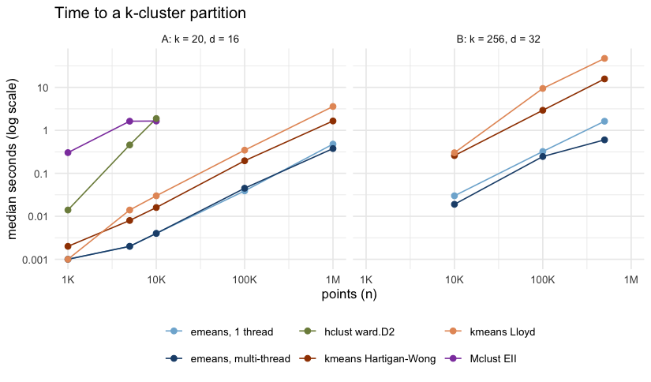
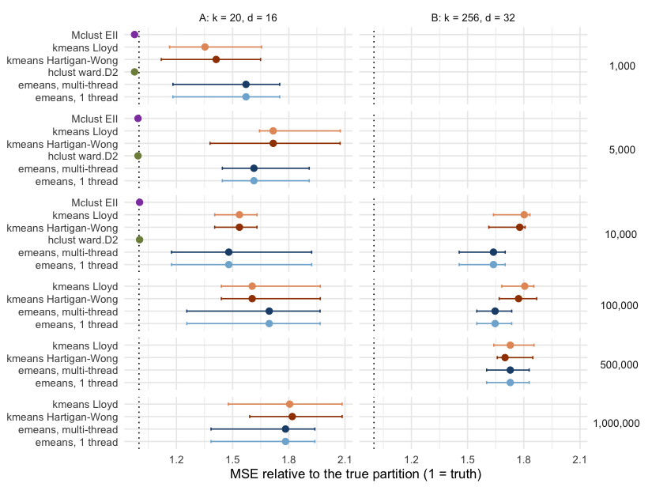

This article times `emeans()` against the clustering tools most R users
reach for: `stats::kmeans()` with Lloyd's algorithm and with the default
Hartigan-Wong algorithm, Ward hierarchical clustering (`stats::hclust()`),
and Gaussian mixture modelling (`mclust::Mclust()`), and checks how good
each partition is.

These methods solve different problems. `hclust()` builds a full tree of
merges and `Mclust()` fits a probabilistic mixture model, while k-means and
e-means minimise the within-cluster sum of squares. Each one is asked for a
`k`-cluster partition of the same data.

The timings come from a single run on the machine described below, stored
with the article; building the site does not re-run them.


``` r
library(emeansR)
library(mclust)
library(dplyr)
library(tidyr)
library(purrr)
library(tibble)
library(ggplot2)
```

## Setup


- Machine: Apple M2, 8 physical cores; R 4.6.1.
- Packages: emeansR 0.1.0, mclust 6.1.3.
- `emeans()` runs with 3 epochs, on 1 thread and on 7 threads.
  Every other method is single-threaded.

Two scenarios, both Gaussian blobs (centers uniform in [-10, 10],
within-cluster standard deviation 2), with `k` equal to the true number of
clusters:

- Scenario A has 20 clusters in 16 dimensions and runs all six methods.
  `hclust()` and `Mclust()` need memory that grows with n², so they stop
  at n = 10,000.
- Scenario B has 256 clusters in 32 dimensions, closer to the large-`k`
  settings in the paper. It runs only the k-means family, because a
  distance matrix is out of reach at these sizes.


``` r
make_data <- function(n, k, d) {
  set.seed(1)
  centers <- matrix(runif(k * d, -10, 10), k)
  truth <- sample(k, n, TRUE)
  list(x = centers[truth, ] + matrix(rnorm(n * d, sd = 2), n), truth = truth)
}
```

Every method is a function from the data matrix to cluster labels.
`kmeans()` uses one random start and up to 25 iterations. `hclust()` and
`Mclust()` include the time to build their distance matrix and hierarchical
initialisation, since a user pays it too. Each configuration runs with
5 seeds (3 seeds for the largest scenario B size). The seed changes the
starting centers; `hclust()` is deterministic, so its seeds only repeat
the timing.


``` r
methods <- tribble(
  ~method,                 ~max_n, ~fit,
  "emeans, 1 thread",      Inf, function(x, k, s) emeans(x, k, nepochs = 3, seed = s, n_threads = 1)$cluster,
  "emeans, multi-thread",  Inf, function(x, k, s) emeans(x, k, nepochs = 3, seed = s, n_threads = threads)$cluster,
  "kmeans Lloyd",          Inf, function(x, k, s) { set.seed(s); suppressWarnings(kmeans(x, k, iter.max = 25, algorithm = "Lloyd"))$cluster },
  "kmeans Hartigan-Wong",  Inf, function(x, k, s) { set.seed(s); suppressWarnings(kmeans(x, k, iter.max = 25))$cluster },
  "hclust ward.D2",        1e4, function(x, k, s) cutree(hclust(dist(x), method = "ward.D2"), k),
  "Mclust EII",            1e4, function(x, k, s) { set.seed(s); Mclust(x, G = k, modelNames = "EII", verbose = FALSE)$classification }
)
```

Quality has two measures. MSE is the within-cluster sum of squares divided
by n, from each method's own cluster means (lower is better). ARI is the
adjusted Rand index against the true labels (1 = perfect).


``` r
mse <- function(x, cl) {
  centers <- rowsum(x, cl) / as.vector(table(cl))
  sum((x - centers[match(cl, sort(unique(cl))), ])^2) / nrow(x)
}

run_one <- function(f, d, k, seed) {
  secs <- system.time(cl <- f(d$x, k, seed))[["elapsed"]]
  tibble(seed = seed, seconds = secs, mse = mse(d$x, cl),
         ari = adjustedRandIndex(cl, d$truth))
}

run_scenario <- function(name, k, dim, sizes, use, seeds_for) {
  map(sizes, function(n) {
    d <- make_data(n, k, dim)
    methods |>
      filter(method %in% use, n <= max_n) |>
      mutate(runs = map(fit, \(f) map(seeds_for(n), \(s) run_one(f, d, k, s)) |> list_rbind())) |>
      select(method, runs) |>
      unnest(runs) |>
      mutate(scenario = name, n = n, k = k, d = dim)
  }) |>
    list_rbind()
}
```


``` r
started <- Sys.time()
raw <- bind_rows(
  run_scenario("A: k = 20, d = 16", k = 20, dim = 16,
               sizes = c(1e3, 5e3, 1e4, 1e5, 1e6), use = methods$method,
               seeds_for = \(n) 1:5),
  run_scenario("B: k = 256, d = 32", k = 256, dim = 32,
               sizes = c(1e4, 1e5, 5e5),
               use = grep("emeans|kmeans", methods$method, value = TRUE),
               seeds_for = \(n) if (n > 1e5) 1:3 else 1:5)
)
run_minutes <- as.numeric(difftime(Sys.time(), started, units = "mins"))
write.csv(raw, "../../.dev/articles/benchmark-results.csv", row.names = FALSE)
```


``` r
results <- raw |>
  group_by(scenario, n, method) |>
  summarise(seconds = median(seconds), mse_med = median(mse), mse_min = min(mse),
            mse_max = max(mse), ari = median(ari), runs = n(),
            floor = first(d) * 2^2,  # expected MSE of the true partition: d * sd^2
            .groups = "drop") |>
  group_by(scenario, n) |>
  mutate(speedup = seconds[method == "kmeans Hartigan-Wong"] / seconds) |>
  ungroup()
```

The full benchmark took 5.6 minutes.

## Time


``` r
method_colours <- c(
  "emeans, 1 thread" = "#7fb3d5", "emeans, multi-thread" = "#1f4e79",
  "kmeans Lloyd" = "#e59866", "kmeans Hartigan-Wong" = "#a04000",
  "hclust ward.D2" = "#7d8c4a", "Mclust EII" = "#8e44ad"
)
ggplot(results, aes(n, seconds, colour = method)) +
  geom_line() +
  geom_point(size = 2) +
  facet_wrap(~scenario) +
  scale_x_log10(labels = scales::label_number(scale_cut = scales::cut_short_scale())) +
  scale_y_log10(labels = scales::label_number(accuracy = 0.001, drop0trailing = TRUE)) +
  scale_colour_manual(values = method_colours) +
  labs(x = "points (n)", y = "median seconds (log scale)", colour = NULL,
       title = "Time to a k-cluster partition") +
  theme_minimal() +
  theme(legend.position = "bottom")
```




In scenario A at n = 10,000, multi-threaded `emeans()` takes
0.004 s, against
0.016 s for the default `kmeans()`,
1.9 s for `hclust()` and
1.6 s for `Mclust()`. At a
million points it takes 0.38 s, against
1.7 s for `kmeans()`.

In scenario B at n = 500,000, `emeans()` takes
0.6 s on 7 threads and
1.6 s on one, against
16 s for `kmeans()`: a
26-fold speed-up.


``` r
results |>
  filter(n %in% c(1e4, 1e6, 5e5)) |>
  arrange(scenario, n, seconds) |>
  mutate(n = format(n, big.mark = ",", scientific = FALSE),
         `MSE (median, range)` = sprintf("%.1f (%.1f-%.1f)", mse_med, mse_min, mse_max)) |>
  select(scenario, n, method, seconds, `speed-up vs kmeans` = speedup,
         `MSE (median, range)`, ARI = ari) |>
  knitr::kable(digits = c(0, 0, 0, 3, 1, 0, 3))
```


|scenario           |n         |method               | seconds| speed-up vs kmeans|MSE (median, range) |   ARI|
|:------------------|:---------|:--------------------|-------:|------------------:|:-------------------|-----:|
|A: k = 20, d = 16  |10,000    |emeans, 1 thread     |   0.004|                4.0|94.7 (75.1-123.0)   | 0.875|
|A: k = 20, d = 16  |10,000    |emeans, multi-thread |   0.004|                4.0|94.7 (75.1-123.0)   | 0.875|
|A: k = 20, d = 16  |10,000    |kmeans Hartigan-Wong |   0.016|                1.0|98.3 (89.9-104.3)   | 0.869|
|A: k = 20, d = 16  |10,000    |kmeans Lloyd         |   0.030|                0.5|98.3 (89.9-104.3)   | 0.869|
|A: k = 20, d = 16  |10,000    |Mclust EII           |   1.647|                0.0|64.2 (64.2-64.2)    | 1.000|
|A: k = 20, d = 16  |10,000    |hclust ward.D2       |   1.883|                0.0|64.2 (64.2-64.2)    | 1.000|
|A: k = 20, d = 16  |1,000,000 |emeans, multi-thread |   0.377|                4.4|114.1 (88.6-124.1)  | 0.778|
|A: k = 20, d = 16  |1,000,000 |emeans, 1 thread     |   0.478|                3.5|114.1 (88.6-124.1)  | 0.778|
|A: k = 20, d = 16  |1,000,000 |kmeans Hartigan-Wong |   1.652|                1.0|116.4 (101.8-133.4) | 0.767|
|A: k = 20, d = 16  |1,000,000 |kmeans Lloyd         |   3.591|                0.5|115.5 (94.5-133.4)  | 0.768|
|B: k = 256, d = 32 |10,000    |emeans, multi-thread |   0.019|               13.6|209.7 (186.3-217.7) | 0.831|
|B: k = 256, d = 32 |10,000    |emeans, 1 thread     |   0.030|                8.6|209.7 (186.3-217.7) | 0.831|
|B: k = 256, d = 32 |10,000    |kmeans Hartigan-Wong |   0.259|                1.0|227.6 (206.5-231.3) | 0.805|
|B: k = 256, d = 32 |10,000    |kmeans Lloyd         |   0.301|                0.9|230.7 (209.7-234.6) | 0.797|
|B: k = 256, d = 32 |500,000   |emeans, multi-thread |   0.601|               26.2|221.2 (205.0-234.1) | 0.800|
|B: k = 256, d = 32 |500,000   |emeans, 1 thread     |   1.629|                9.6|221.2 (205.0-234.1) | 0.800|
|B: k = 256, d = 32 |500,000   |kmeans Hartigan-Wong |  15.718|                1.0|217.6 (212.3-236.6) | 0.822|
|B: k = 256, d = 32 |500,000   |kmeans Lloyd         |  47.198|                0.3|221.2 (209.9-237.4) | 0.815|


## Quality

Each point is the median MSE over seeds divided by d × sd², the expected
MSE of the true partition, so 1 means as good as the truth. The bars span
the best and worst seed.


``` r
results |>
  mutate(n = factor(format(n, big.mark = ",", scientific = FALSE),
                    levels = format(sort(unique(n)), big.mark = ",", scientific = FALSE))) |>
  ggplot(aes(mse_med / floor, method, colour = method)) +
  geom_vline(xintercept = 1, linetype = "dotted") +
  geom_errorbarh(aes(xmin = mse_min / floor, xmax = mse_max / floor), height = 0.25) +
  geom_point(size = 2.2) +
  facet_grid(n ~ scenario, scales = "free_y", space = "free_y") +
  scale_colour_manual(values = method_colours, guide = "none") +
  labs(x = "MSE relative to the true partition (1 = truth)", y = NULL) +
  theme_minimal() +
  theme(strip.text.y = element_text(angle = 0))
#> Warning: `geom_errorbarh()` was deprecated in ggplot2 4.0.0.
#> ℹ Please use the `orientation` argument of `geom_errorbar()` instead.
#> This warning is displayed once per session.
#> Call `lifecycle::last_lifecycle_warnings()` to see where this warning was
#> generated.
#> `height` was translated to `width`.
```




In scenario A, with few well-separated clusters, `hclust()` and `Mclust()`
recover the true clusters (ARI 1, MSE
64.2). Both k-means variants and e-means get stuck
from bad random starts and land in the same wide band of local minima:
across seeds their MSE spans 72 to 133.
e-means is the fastest of the three, and its median MSE is sometimes better
and sometimes worse than `kmeans()`. If the data are small enough for
`hclust()`, use it; otherwise run `kmeans()` or `emeans()` with several
starts and keep the best.

In scenario B, with many clusters, e-means is much faster at similar
quality. At n = 500,000 it takes 0.6 s
against 16 s for `kmeans()`, with median
MSE 221.2 against
217.6
(+1.7%). At n = 10,000 and
100,000 its median MSE is lower than that of `kmeans()`
(-7.9% and
-7.1%).

From a single random start, neither k-means nor e-means reaches the true
partition in either scenario: every k-means-family result sits above the
noise floor of d × sd² (64 in A, 128 in B).

## Caveats

- Synthetic, spherical blobs on one machine. Data with unequal or elongated
  clusters favour `Mclust()`'s richer models, which take far longer than
  the `EII` model timed here.
- `kmeans()` uses one random start. With `nstart = 10` it takes about ten
  times as long and keeps the best of the ten; running `emeans()` with
  several seeds and keeping the best works the same way.
- The 3-epoch budget for `emeans()` follows the paper's finding that 1.2 to
  3 epochs are usually enough. The default, `nepochs = 5`, takes longer;
  this benchmark did not measure its quality.
- Times include everything a call does, including `emeans()`'s final
  assignment of every row to the returned centers.

## Session


```
#> R version 4.6.1 (2026-06-24)
#> macOS Golden Gate 27.2
```
