<style>
.figcaption, figcaption, .caption { font-weight: bold; }
</style>

This article compares `emeans()` (Bessa et al., 2026) with ten other clustering functions available in R on the MNIST handwritten digits (LeCun et al., 1998): 70,000 images of 28 by 28 pixels, each one a row of 784 grey levels. Each method is asked for 10, 100 and 1,000 clusters on subsets of 5,000 to 70,000 images. The first half compares run time, peak memory and partition quality; the second draws the clusters on a UMAP embedding and shows the centroids as images.

The runs took about seven and a half hours, and building the site does not repeat them. The [scripts in `scripts_vignettes/mnist-benchmark`](https://github.com/ToledoEM/emeansR/tree/main/scripts_vignettes/mnist-benchmark) download the data, run each configuration once in a fresh R process and save timings, labels and centroids to disk; the chunks below only read those files.


``` r
library(tidyverse)
library(patchwork)
library(MetBrewer)
library(ggrepel)
library(scales)
library(aricode)
```


``` r
out <- ".dev/bench/mnist/out"
env <- readRDS(file.path(out, "env.rds"))
runs <- read_csv(file.path(out, "runs.csv"), show_col_types = FALSE)
trace <- read_csv(file.path(out, "emeans_trace.csv"), show_col_types = FALSE)
recipe <- read_csv(file.path(out, "emeans_recipe.csv"), show_col_types = FALSE)
mnist <- readRDS(file.path(out, "data", "mnist.rds"))
umap <- readRDS(file.path(out, "data", "umap.rds"))
subsets <- readRDS(file.path(out, "data", "subsets.rds"))
digit <- mnist$label
read_labels <- function(fit_id) readRDS(file.path(out, "labels", paste0(fit_id, ".rds")))
read_centers <- function(run_id) readRDS(file.path(out, "centers", paste0(run_id, ".rds")))
```


``` r
method_key <- c(
  emeans_single = "e-means (single)", emeans_double = "e-means (double)",
  kmeans_hw = "kmeans Hartigan-Wong", kmeans_lloyd = "kmeans Lloyd",
  clusterr_kmeans = "ClusterR KMeans", clusterr_minibatch = "ClusterR mini-batch",
  clara = "clara", mclust_eii = "Mclust EII",
  stats_hclust = "hclust Ward", flashclust = "flashClust Ward",
  fastcluster_hclust = "fastcluster hclust", fastcluster_vector = "fastcluster vector"
)
# Colours from MetBrewer "Signac" (methods) and "Redon" (digits), picked so that methods of the
# same kind, and digits that sit next to each other on the UMAP, get distinct colours.
signac <- as.character(met.brewer("Signac", 14))
pal_method <- set_names(signac[c(3, 2, 12, 11, 13, 14, 5, 6, 9, 10, 7, 4)], method_key)
redon <- as.character(met.brewer("Redon", 12))
pal_digit <- set_names(redon[c(6, 1, 11, 2, 9, 5, 8, 12, 3, 4)], 0:9)
pal_status <- c(ok = "#3B7C70", timeout = "#CE9642", skipped = "#B6B6B6", "not run" = "#F0F0F0")

theme_set(theme_minimal(base_size = 11) +
            theme(panel.grid.minor = element_blank(), legend.position = "bottom",
                  strip.text = element_text(face = "bold")))
scale_n <- scale_x_log10(breaks = c(5e3, 1e4, 2e4, 3e4, 7e4),
                         labels = label_number(scale_cut = cut_short_scale()))

# One row per run. The e-means epoch sweep (nepochs != 5) is kept apart.
runs <- runs |>
  mutate(variant = if_else(method == "emeans", paste0("emeans_", precision), method),
         variant = factor(method_key[variant], levels = method_key))
bench <- filter(runs, method != "emeans" | nepochs == 5)
```

## Setup


|Item           |Value                                               |
|:--------------|:---------------------------------------------------|
|CPU            |Apple M2 with 8 cores (4 performance, 4 efficiency) |
|Memory         |16 GB                                               |
|OS             |macOS 27.2.1                                        |
|R              |R version 4.6.1 (2026-06-24)                        |
|BLAS           |libRblas.0.dylib                                    |
|emeansR commit |1d7c539                                             |
|Input          |raw 784 pixels scaled 0-1                           |
|Threads        |1 per run, runs one at a time                       |
|Time limit     |15 minutes per run                                  |


The input is the raw pixels scaled to [0, 1], with no PCA. Every method runs on one thread (`n_threads = 1` for `emeans()`, and `OMP_NUM_THREADS`, `VECLIB_MAXIMUM_THREADS`, `OPENBLAS_NUM_THREADS` set to 1 for the rest), and runs go one after another so that they do not compete for memory bandwidth. The subsets are nested and stratified by digit, so the 5,000 images are part of the 10,000, and so on.

The partitioning methods run with seeds 1, 2 and 3. A run longer than 15 minutes is stopped and recorded as a timeout; larger subsets of the same method and `k` are then skipped. The hierarchical methods are deterministic: they build one tree per subset, which is then cut at 10, 100 and 1,000 clusters.

| Function | Settings | Algorithm |
|---|---|---|
| `emeansR::emeans()` | `nepochs = 5`, `precision = "single"` and `"double"` | Bessa et al. (2026) |
| `stats::kmeans()` | Hartigan-Wong and Lloyd, `iter.max = 100`, `nstart = 1` | Hartigan and Wong (1979); Lloyd (1982) |
| `ClusterR::KMeans_rcpp()` | k-means++ start, `max_iters = 100` | Lloyd (1982); Arthur and Vassilvitskii (2007) |
| `ClusterR::MiniBatchKmeans()` | batch of 1,024 rows, k-means++ start, `max_iters = 100` | Sculley (2010) |
| `cluster::clara()` | 50 samples, `pamLike = TRUE` | Kaufman and Rousseeuw (1990) |
| `mclust::Mclust()` | model `"EII"`, `k = 10` only, up to 10,000 images | Scrucca et al. (2016) |
| `stats::hclust()`, `fastcluster::hclust()` | `"ward.D2"` on `dist()` | Ward (1963); Murtagh and Legendre (2014); Müllner (2013) |
| `flashClust::flashClust()` | `"ward"` on squared distances (same merges as `"ward.D2"`) | Langfelder and Horvath (2012) |
| `fastcluster::hclust.vector()` | `"ward"`, no distance matrix | Müllner (2013) |

The package versions used for the runs:


|Package     |Version |Methods                                         |
|:-----------|:-------|:-----------------------------------------------|
|ClusterR    |1.3.7   |ClusterR KMeans, ClusterR mini-batch            |
|cluster     |2.1.8.3 |clara                                           |
|emeansR     |0.1.0   |e-means (double), e-means (single)              |
|fastcluster |1.3.0   |fastcluster hclust, fastcluster vector          |
|flashClust  |1.1.4   |flashClust Ward                                 |
|mclust      |6.1.3   |Mclust EII                                      |
|stats       |4.6.1   |kmeans Hartigan-Wong, kmeans Lloyd, hclust Ward |


## The data


<details><summary>Show code</summary>

``` r
digit_tiles <- function(m, ids) {
  # Rows of m are images stored row by row (pixel 1 is top left).
  as_tibble(m, .name_repair = ~ as.character(seq_along(.x))) |>
    mutate(id = ids) |>
    pivot_longer(-id, names_to = "pixel", values_to = "value") |>
    mutate(pixel = as.integer(pixel) - 1L, row = pixel %/% 28L, col = pixel %% 28L)
}

set.seed(42)
sample_ids <- map(0:9, \(d) sample(which(digit == d), 6)) |> unlist()
digit_tiles(mnist$x[sample_ids, ], sample_ids) |>
  mutate(digit = digit[id], copy = match(id, sample_ids) %% 6) |>
  ggplot(aes(col, -row, fill = value)) +
  geom_raster() +
  facet_grid(copy ~ digit, switch = "y") +
  scale_fill_gradientn(colours = met.brewer("Tam", direction = -1)) +
  coord_equal() +
  theme_void() +
  theme(legend.position = "none", strip.text.y = element_blank())
```


</details>

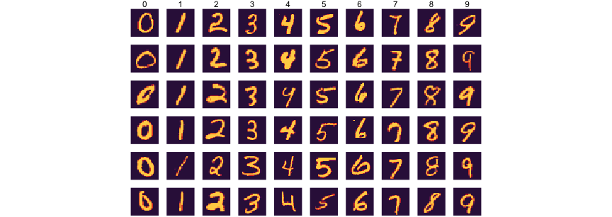

## Which runs finished


<details><summary>Show code</summary>

``` r
status_grid <- bench |>
  group_by(variant, n, k) |>
  summarise(status = case_when(all(status == "ok") ~ "ok",
                               any(status == "timeout") ~ "timeout",
                               .default = "skipped"), .groups = "drop") |>
  complete(variant, n, k, fill = list(status = "not run")) |>
  mutate(status = factor(status, names(pal_status)))

ggplot(status_grid, aes(factor(n), fct_rev(variant), fill = status)) +
  geom_tile(colour = "white", linewidth = 0.8) +
  facet_wrap(~k, labeller = label_both) +
  scale_fill_manual(values = pal_status, drop = FALSE) +
  scale_x_discrete(labels = \(x) label_number(scale_cut = cut_short_scale())(as.numeric(x))) +
  labs(x = "Images", y = NULL, fill = NULL)
```


</details>

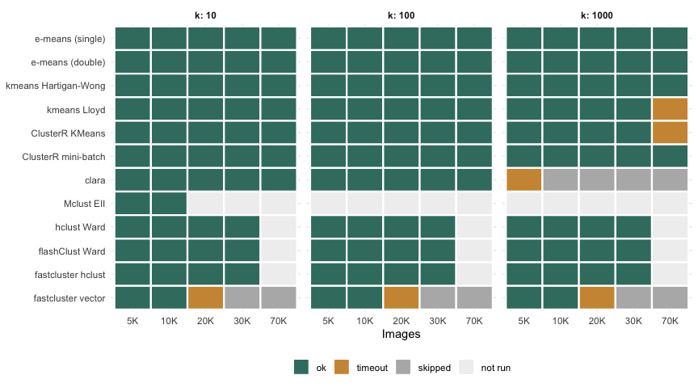


Of 368 planned runs (12 more for the e-means epoch sweep below), 338 finished, 6 hit the time limit and the rest were skipped after a timeout. The timeouts were:


|Method             | Images|     k|
|:------------------|------:|-----:|
|kmeans Lloyd       | 70,000| 1,000|
|ClusterR KMeans    | 70,000| 1,000|
|clara              |  5,000| 1,000|
|fastcluster vector | 20,000|    10|
|fastcluster vector | 20,000|   100|
|fastcluster vector | 20,000| 1,000|


## Run time


``` r
timing <- bench |>
  filter(status %in% c("ok", "timeout")) |>
  mutate(elapsed_s = if_else(status == "timeout", env$timeout_s, elapsed_s)) |>
  group_by(variant, family, n, k) |>
  summarise(med = median(elapsed_s), lo = min(elapsed_s), hi = max(elapsed_s),
            timeout = any(status == "timeout"), .groups = "drop")
```


<details><summary>Show code</summary>

``` r
ggplot(timing, aes(n, med, colour = variant, fill = variant)) +
  geom_hline(yintercept = env$timeout_s, linetype = "dashed", colour = "grey50") +
  geom_ribbon(aes(ymin = lo, ymax = hi), alpha = 0.15, colour = NA) +
  geom_line(linewidth = 0.7) +
  geom_point(aes(shape = timeout), size = 2) +
  facet_wrap(~k, labeller = label_both) +
  scale_n +
  scale_y_log10(labels = label_number(accuracy = 0.1, suffix = " s")) +
  scale_colour_manual(values = pal_method, aesthetics = c("colour", "fill")) +
  scale_shape_manual(values = c(`FALSE` = 16, `TRUE` = 4), guide = "none") +
  labs(x = "Images", y = "Elapsed time (log scale)", colour = NULL, fill = NULL,
       caption = "Line: median of 3 seeds; band: fastest to slowest seed; ×: stopped at the 15-minute limit.") +
  guides(colour = guide_legend(nrow = 3))
```


</details>

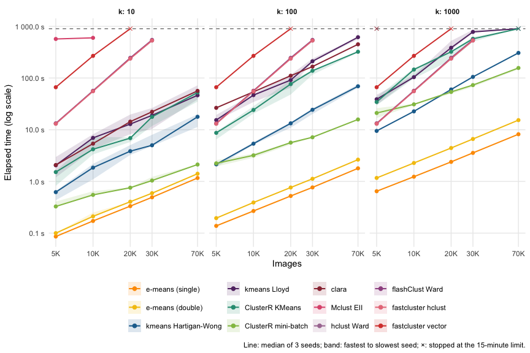


On all 70,000 images `emeans()` in single precision took 1.2, 1.8 and 8.2 seconds for 10, 100 and 1,000 clusters. `kmeans()` with the default Hartigan-Wong algorithm took 18, 69 and 306 seconds. The next plot divides each method's median time by the time of `emeans()` in single precision.


<details><summary>Show code</summary>

``` r
ggplot(speedup, aes(ratio, fct_reorder(variant, ratio), colour = variant)) +
  geom_vline(xintercept = 1, colour = "grey60") +
  geom_segment(aes(x = 1, xend = ratio, yend = variant), linewidth = 0.6) +
  geom_point(size = 3) +
  geom_text(aes(label = paste0(label_number(0.1)(ratio), "×")), hjust = -0.35, size = 3.2,
            show.legend = FALSE) +
  facet_wrap(~k, labeller = label_both) +
  scale_x_log10(expand = expansion(mult = c(0.05, 0.3))) +
  scale_colour_manual(values = pal_method, guide = "none") +
  labs(x = "Time relative to e-means (single), 70,000 images (log scale)", y = NULL)
```


</details>

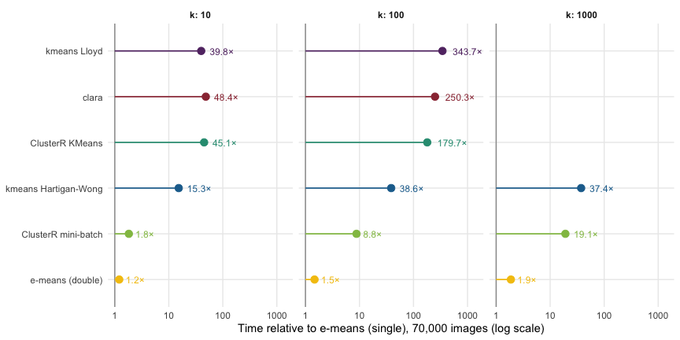

The hierarchical methods spend most of their time on the distance matrix. `fastcluster::hclust.vector()` skips the matrix and works on the vectors directly, which saves memory but was the slowest of the four.


<details><summary>Show code</summary>

``` r
bench |>
  filter(family == "hierarchical", status == "ok", k == 10) |>
  select(variant, n, `distance matrix` = dist_s, tree = tree_s, `cut at k = 10` = cut_s) |>
  pivot_longer(-c(variant, n), names_to = "step", values_to = "seconds") |>
  filter(!is.na(seconds)) |>
  mutate(step = fct_rev(factor(step, c("distance matrix", "tree", "cut at k = 10")))) |>
  ggplot(aes(factor(n), seconds, fill = step)) +
  geom_col(width = 0.7) +
  facet_wrap(~variant, nrow = 1) +
  scale_fill_manual(values = as.character(met.brewer("Hokusai2", 3))) +
  scale_x_discrete(labels = \(x) label_number(scale_cut = cut_short_scale())(as.numeric(x))) +
  labs(x = "Images", y = "Seconds", fill = NULL)
```


</details>

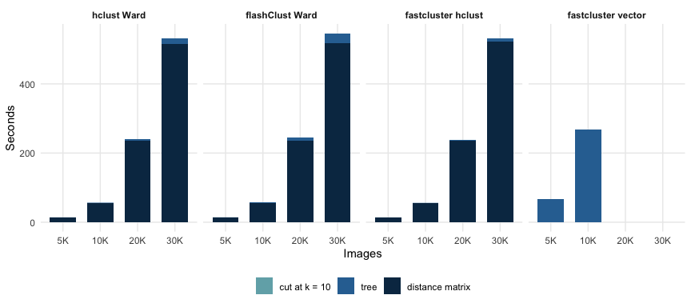

## Memory

Peak memory is the maximum resident set size of the R process reported by `/usr/bin/time -l`, minus the size of the process after it loaded the data (`rss_before_mb`). It includes copies the method makes of its input.


<details><summary>Show code</summary>

``` r
mem <- bench |>
  filter(status == "ok") |>
  mutate(mem_mb = max_rss_mb - rss_before_mb) |>
  group_by(variant, n, k) |>
  summarise(mem_mb = median(mem_mb), .groups = "drop")
ggplot(mem, aes(n, mem_mb, colour = variant)) +
  geom_line(linewidth = 0.7) +
  geom_point(size = 1.8) +
  facet_wrap(~k, labeller = label_both) +
  scale_n +
  scale_y_log10(labels = label_number(suffix = " MB", big.mark = ",")) +
  scale_colour_manual(values = pal_method) +
  labs(x = "Images", y = "Peak memory above baseline (log scale)", colour = NULL) +
  guides(colour = guide_legend(nrow = 3))
```


</details>

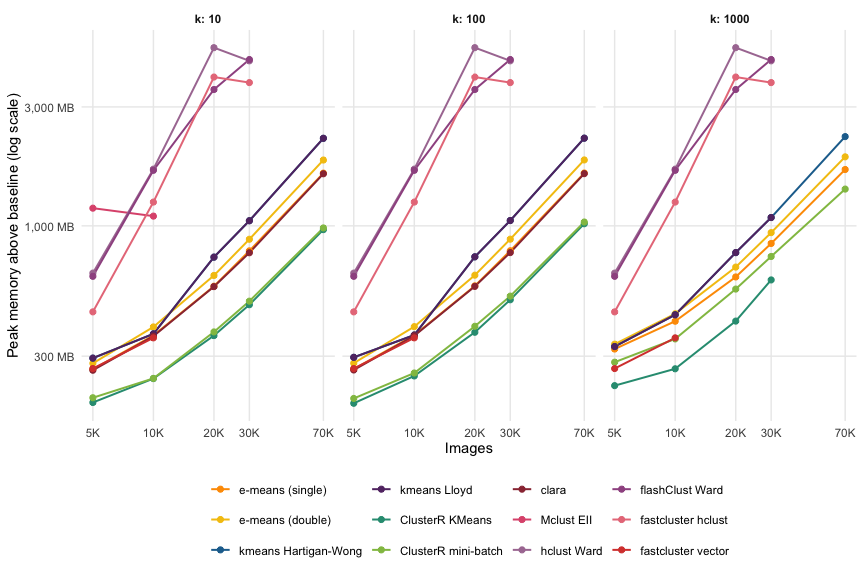

The input itself takes 419 MB at 70,000 images in double precision. The distance matrix of the Ward methods grows with the square of the number of images: 3,433 MB at 30,000 images.

## Quality of the partitions

The main measure is the inertia: the mean squared Euclidean distance from each image to the mean of its cluster, lower being better. It is computed the same way for every method, from the labels, so `clara()` medoids and `Mclust()` means do not enter it. Agreement with the ten digits is also reported, as the adjusted Rand index (ARI; Hubert and Arabie, 1985), normalised and adjusted mutual information (NMI, AMI; Vinh et al., 2010) and purity, but with 100 or 1,000 clusters the ARI is low by construction, since each digit is split over many clusters.


<details><summary>Show code</summary>

``` r
hw_ref <- bench |>
  filter(variant == "kmeans Hartigan-Wong", status == "ok") |>
  group_by(n, k) |>
  summarise(ref = median(inertia), .groups = "drop")
inertia_rel <- bench |>
  filter(status == "ok") |>
  inner_join(hw_ref, by = c("n", "k")) |>
  mutate(rel = inertia / ref - 1) |>
  group_by(variant, n, k) |>
  summarise(med = median(rel), lo = min(rel), hi = max(rel), .groups = "drop")
ggplot(inertia_rel, aes(n, med, colour = variant)) +
  geom_hline(yintercept = 0, colour = "grey50") +
  geom_pointrange(aes(ymin = lo, ymax = hi), position = position_dodge(width = 0.08),
                  size = 0.25, linewidth = 0.5) +
  geom_line(position = position_dodge(width = 0.08), linewidth = 0.4) +
  facet_wrap(~k, labeller = label_both, scales = "free_y") +
  scale_n +
  scale_y_continuous(labels = label_percent()) +
  scale_colour_manual(values = pal_method) +
  labs(x = "Images", y = "Inertia relative to kmeans Hartigan-Wong", colour = NULL) +
  guides(colour = guide_legend(nrow = 3))
```


</details>

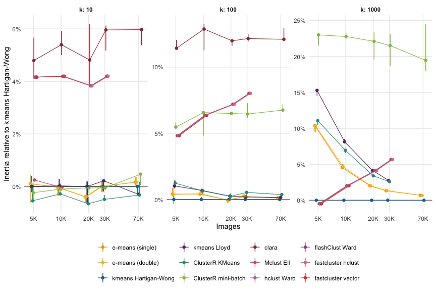


At 70,000 images `emeans()` and Hartigan-Wong reach almost the same inertia: 39.4 against 39.3 at `k = 10`, 28.0 against 27.9 at `k = 100` and 20.3 against 20.1 at `k = 1000`. ClusterR's mini-batch k-means falls behind as `k` grows (24.0 at `k = 1000`).

The next plot puts time and inertia together. Points further down and to the left are better.


<details><summary>Show code</summary>

``` r
pareto <- bench |>
  filter(n == 70000, status == "ok") |>
  group_by(variant, k) |>
  summarise(time = median(elapsed_s), inertia = median(inertia), .groups = "drop")
ggplot(pareto, aes(time, inertia, colour = variant)) +
  geom_point(size = 3) +
  geom_text_repel(aes(label = variant), size = 3, show.legend = FALSE, min.segment.length = 0,
                  seed = 1) +
  facet_wrap(~k, labeller = label_both, scales = "free") +
  scale_x_log10(labels = label_number(suffix = " s")) +
  scale_colour_manual(values = pal_method, guide = "none") +
  labs(x = "Elapsed time (log scale)", y = "Inertia")
```


</details>

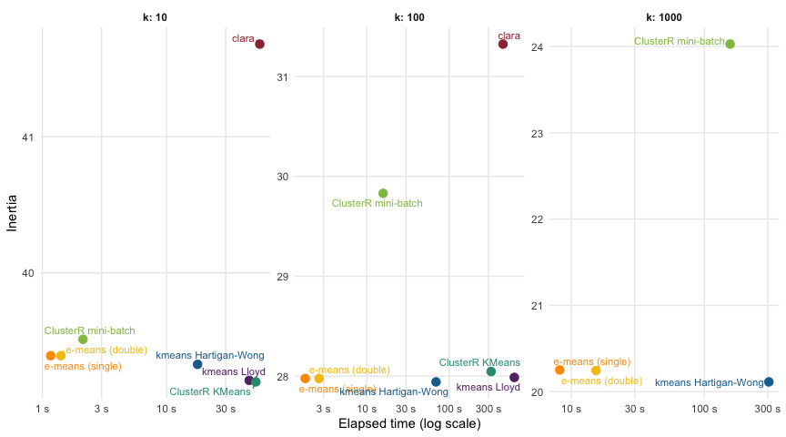

With ten clusters every method can be compared against the digits. At 10,000 images, the largest subset on which all twelve finished:


<details><summary>Show code</summary>

``` r
bench |>
  filter(n == 10000, k == 10, status == "ok") |>
  select(variant, seed, ARI = ari, NMI = nmi, AMI = ami, Purity = purity) |>
  pivot_longer(ARI:Purity, names_to = "metric") |>
  ggplot(aes(value, fct_rev(variant), colour = variant)) +
  stat_summary(fun = median, geom = "point", shape = "|", size = 6) +
  geom_point(alpha = 0.6, size = 2) +
  facet_wrap(~metric, nrow = 1, scales = "free_x") +
  scale_colour_manual(values = pal_method, guide = "none") +
  labs(x = NULL, y = NULL,
       caption = "Dots: seeds; bar: median.")
```


</details>

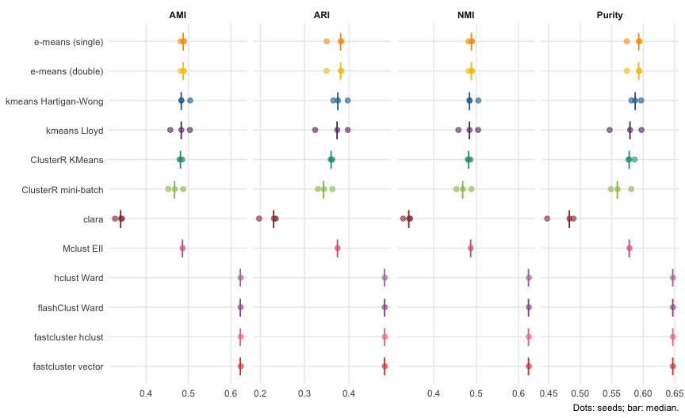


The Ward trees match the digits best (ARI 0.48, against 0.38 for `emeans()` and 0.38 for Hartigan-Wong), although their inertia is 4.2% higher.

With more clusters, purity rises because smaller clusters hold fewer mixed digits. NMI falls, since it also penalises splitting each digit over many clusters:


<details><summary>Show code</summary>

``` r
bench |>
  filter(n == 30000, status == "ok") |>
  group_by(variant, k) |>
  summarise(across(c(nmi, purity), median), .groups = "drop") |>
  pivot_longer(c(nmi, purity), names_to = "metric") |>
  mutate(metric = recode(metric, nmi = "NMI", purity = "Purity")) |>
  ggplot(aes(k, value, colour = variant)) +
  geom_line(linewidth = 0.7) +
  geom_point(size = 2) +
  facet_wrap(~metric, scales = "free_y") +
  scale_x_log10(breaks = c(10, 100, 1000)) +
  scale_colour_manual(values = pal_method) +
  labs(x = "k (log scale)", y = NULL, colour = NULL) +
  guides(colour = guide_legend(nrow = 3))
```


</details>

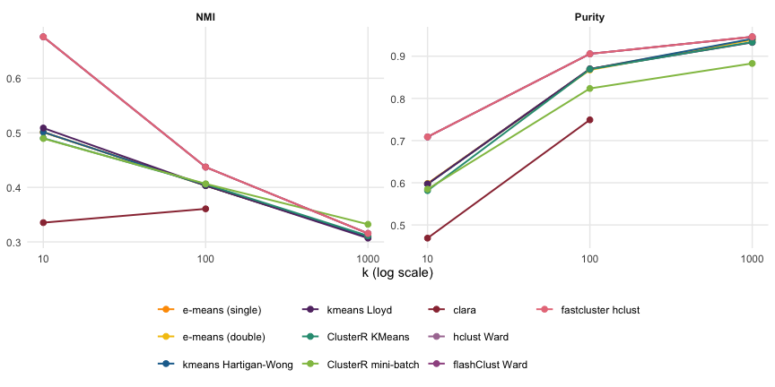

## Inside e-means

### Single and double precision

With `precision = "single"` the data are stored and distances computed in 32-bit floats, while centroids and sums stay in 64 bits. Pairing runs by subset, `k` and seed:


<details><summary>Show code</summary>

``` r
prec <- bench |>
  filter(method == "emeans", status == "ok") |>
  select(precision, n, k, seed, elapsed_s, inertia) |>
  pivot_wider(names_from = precision, values_from = c(elapsed_s, inertia)) |>
  mutate(speed = elapsed_s_double / elapsed_s_single,
         inertia_diff = inertia_single / inertia_double - 1)
p1 <- ggplot(prec, aes(n, speed, colour = factor(k))) +
  geom_hline(yintercept = 1, colour = "grey60") +
  geom_point(alpha = 0.7) +
  stat_summary(fun = median, geom = "line") +
  scale_n +
  scale_colour_manual(values = as.character(met.brewer("Egypt", 3))) +
  labs(x = "Images", y = "Time double / time single", colour = "k")
p2 <- ggplot(prec, aes(n, inertia_diff, colour = factor(k))) +
  geom_hline(yintercept = 0, colour = "grey60") +
  geom_point(alpha = 0.7) +
  scale_n +
  scale_y_continuous(labels = label_percent(0.001)) +
  scale_colour_manual(values = as.character(met.brewer("Egypt", 3))) +
  labs(x = "Images", y = "Inertia single / double - 1", colour = "k")
p1 + p2 + plot_layout(guides = "collect")
```


</details>

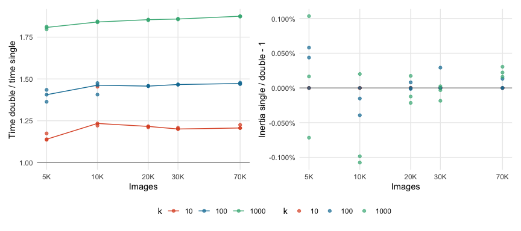

Double precision takes 1.2 times as long as single at `k = 10` and 1.9 times at `k = 1000` (70,000 images). The inertia of the two differs by 0.107% at most.

### Number of epochs

The default is five passes over the data. On all images with `k = 100` and double precision:


<details><summary>Show code</summary>

``` r
sweep <- runs |>
  filter(method == "emeans", precision == "double", n == 70000, k == 100, status == "ok")
hw100 <- in70$inertia[in70$variant == "kmeans Hartigan-Wong" & in70$k == 100]
p1 <- ggplot(sweep, aes(nepochs, elapsed_s)) +
  geom_point(colour = pal_method[["e-means (double)"]], size = 2) +
  stat_summary(fun = median, geom = "line", colour = pal_method[["e-means (double)"]]) +
  scale_x_continuous(breaks = c(1, 2, 3, 5, 10)) +
  labs(x = "nepochs", y = "Seconds")
p2 <- ggplot(sweep, aes(nepochs, inertia)) +
  geom_hline(yintercept = hw100, linetype = "dashed", colour = pal_method[["kmeans Hartigan-Wong"]]) +
  annotate("text", x = 10, y = hw100, label = "kmeans Hartigan-Wong", vjust = -0.6, hjust = 1,
           size = 3, colour = pal_method[["kmeans Hartigan-Wong"]]) +
  geom_point(colour = pal_method[["e-means (double)"]], size = 2) +
  stat_summary(fun = median, geom = "line", colour = pal_method[["e-means (double)"]]) +
  scale_x_continuous(breaks = c(1, 2, 3, 5, 10)) +
  labs(x = "nepochs", y = "Inertia")
p1 + p2
```


</details>

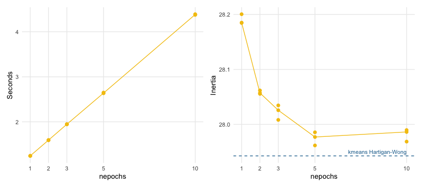


One epoch takes 1.2 seconds and reaches an inertia of 28.19; ten take 4.4 seconds for 27.99. Hartigan-Wong reaches 27.94 in 69 seconds.

### Objective and balance per epoch

`emeans()` records the objective of each epoch (the summed squared distance of the rows seen in that epoch, divided here by their number) and the imbalance of cluster sizes (the mean of squared sizes over the squared mean size; 1 means equal sizes).


<details><summary>Show code</summary>

``` r
trace_meta <- trace |>
  inner_join(select(runs, run_id, n, k, seed, precision, nepochs), by = "run_id") |>
  inner_join(select(recipe, run_id, epoch_rows), by = "run_id") |>
  filter(precision == "double", nepochs == 5) |>
  mutate(obj = obj / epoch_rows)
p1 <- ggplot(trace_meta, aes(epoch, obj, colour = factor(n), group = run_id)) +
  geom_line(alpha = 0.7) +
  facet_wrap(~k, labeller = label_both, scales = "free_y") +
  labs(x = "Epoch", y = "Objective per row")
p2 <- ggplot(trace_meta, aes(epoch, imbalance, colour = factor(n), group = run_id)) +
  geom_line(alpha = 0.7) +
  facet_wrap(~k, labeller = label_both, scales = "free_y") +
  labs(x = "Epoch", y = "Imbalance")
(p1 / p2 + plot_layout(guides = "collect")) &
  scale_colour_manual(values = as.character(met.brewer("Hokusai3", 5)),
                      labels = \(x) label_comma()(as.numeric(x)), name = "Images")
```


</details>

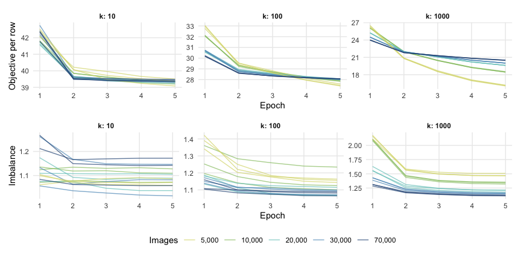

### The recipe

`emeans_recipe()` sets the batch size and the starting step size `alpha0` from `n`, `k`, `d` and `nepochs`, following the scaling laws in the paper. These are the values used in the runs above:


<details><summary>Show code</summary>

``` r
recipe_grid <- recipe |>
  inner_join(select(runs, run_id, n, k, precision), by = "run_id") |>
  filter(precision == "double", nepochs == 5) |>
  distinct(n, k, batch_size, alpha0, total_steps)
p1 <- ggplot(recipe_grid, aes(n, batch_size, colour = factor(k))) +
  geom_line() + geom_point() +
  scale_n + scale_y_log10(labels = label_comma()) +
  labs(x = "Images", y = "Batch size", colour = "k")
p2 <- ggplot(recipe_grid, aes(n, alpha0, colour = factor(k))) +
  geom_line() + geom_point() +
  scale_n +
  labs(x = "Images", y = "alpha0", colour = "k")
p3 <- ggplot(recipe_grid, aes(n, total_steps, colour = factor(k))) +
  geom_line() + geom_point() +
  scale_n + scale_y_log10(labels = label_comma()) +
  labs(x = "Images", y = "Total steps", colour = "k")
(p1 + p2 + p3 + plot_layout(guides = "collect")) &
  scale_colour_manual(values = as.character(met.brewer("Egypt", 3)))
```


</details>

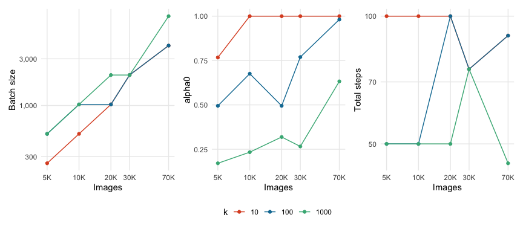

## Stability across seeds

For each partitioning method, subset and `k`, the three seeds give three partitions. The plot shows the adjusted Rand index between each pair of them; 1 means the seeds agree exactly.


<details><summary>Show code</summary>

``` r
seed_ari <- bench |>
  filter(family != "hierarchical", status == "ok") |>
  group_by(variant, n, k) |>
  filter(n() == 3) |>
  summarise(fits = list(fit_id), .groups = "drop") |>
  mutate(ari = map(fits, \(f) {
    lab <- map(f, read_labels)
    combn(3, 2, \(p) ARI(lab[[p[1]]], lab[[p[2]]]))
  })) |>
  select(-fits) |>
  unnest(ari)
ggplot(seed_ari, aes(n, ari, colour = variant)) +
  geom_point(alpha = 0.6, size = 1.6) +
  stat_summary(fun = median, geom = "line") +
  facet_wrap(~k, labeller = label_both) +
  scale_n +
  scale_colour_manual(values = pal_method) +
  labs(x = "Images", y = "ARI between seeds", colour = NULL) +
  guides(colour = guide_legend(nrow = 3))
```


</details>

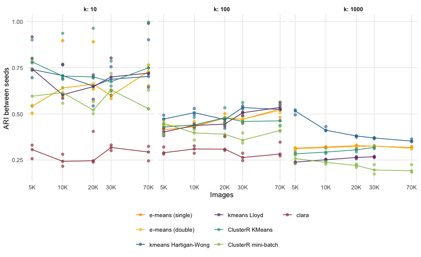


With `k = 10` the ARI between two seeds ranges from 0.22 to 1.00. At `k = 1000` and 70,000 images, kmeans Hartigan-Wong is the most repeatable (median ARI 0.35), with `emeans()` at 0.32.

## Clusters on a UMAP embedding

The embedding is a UMAP (McInnes et al., 2018) of the first 50 principal components of all 70,000 images (`uwot::umap()`, 15 neighbours, `min_dist = 0.1`). It is only for display: every method clustered the raw pixels. Coloured by the true digit:


<details><summary>Show code</summary>

``` r
um <- tibble(u1 = umap[, 1], u2 = umap[, 2], digit = factor(digit))
digit_centres <- um |>
  group_by(digit) |>
  summarise(across(c(u1, u2), median))
ggplot(um, aes(u1, u2, colour = digit)) +
  geom_point(size = 0.05, alpha = 0.4, shape = 16) +
  geom_label(data = digit_centres, aes(label = digit), fill = "white", size = 5,
             linewidth = 0, show.legend = FALSE) +
  scale_colour_manual(values = pal_digit, guide = "none") +
  coord_equal() +
  theme_void()
```


</details>

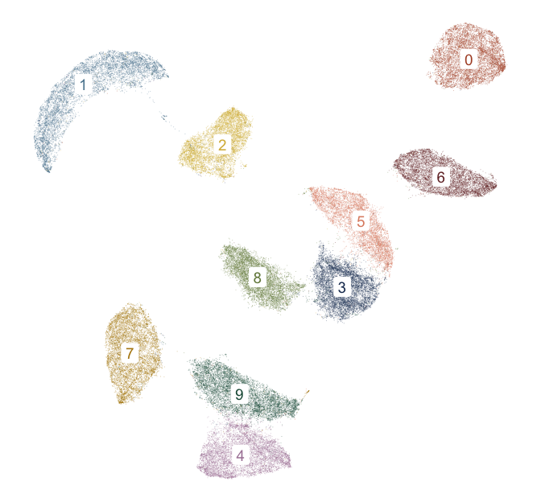

### Ten clusters

Each cluster is coloured by the digit most of its images belong to. When two clusters share a colour, the method split one digit in two, which means some other digit has no cluster of its own.


``` r
k10_methods <- c("e-means (single)", "kmeans Hartigan-Wong", "kmeans Lloyd", "ClusterR KMeans",
                 "ClusterR mini-batch", "clara")
k10_fits <- bench |>
  filter(n == 70000, k == 10, seed == 1, status == "ok", variant %in% k10_methods) |>
  select(variant, fit_id, run_id)
majority <- function(cl) {
  tibble(cluster = cl, digit = digit) |>
    count(cluster, digit) |>
    slice_max(order_by = n, n = 1, with_ties = FALSE, by = cluster) |>
    select(cluster, major = digit)
}
k10 <- k10_fits |>
  mutate(cluster = map(fit_id, read_labels)) |>
  mutate(points = map(cluster, \(cl) {
    um |>
      mutate(cluster = cl) |>
      left_join(majority(cl), by = "cluster") |>
      mutate(major = factor(major, 0:9))
  })) |>
  select(variant, points) |>
  unnest(points) |>
  mutate(variant = factor(variant, k10_methods), wrong = as.character(digit) != as.character(major))
```


<details><summary>Show code</summary>

``` r
ggplot(k10, aes(u1, u2, colour = major)) +
  geom_point(size = 0.02, alpha = 0.35, shape = 16) +
  facet_wrap(~variant, ncol = 3) +
  scale_colour_manual(values = pal_digit, drop = FALSE) +
  coord_equal() +
  theme_void() +
  theme(legend.position = "bottom", strip.text = element_text(face = "bold")) +
  guides(colour = guide_legend(nrow = 1, override.aes = list(size = 3, alpha = 1))) +
  labs(colour = "Majority digit of the cluster")
```


</details>

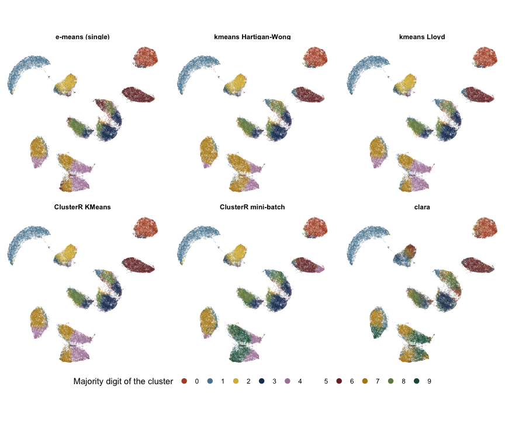

The images whose digit differs from the majority of their cluster, in red:


<details><summary>Show code</summary>

``` r
wrong_rate <- k10 |>
  group_by(variant) |>
  summarise(rate = mean(wrong))
ggplot(arrange(k10, wrong), aes(u1, u2, colour = wrong)) +
  geom_point(size = 0.02, alpha = 0.35, shape = 16) +
  geom_text(data = wrong_rate, aes(x = -Inf, y = Inf, label = label_percent(0.1)(rate)),
            inherit.aes = FALSE, hjust = -0.2, vjust = 1.5, size = 3.5) +
  facet_wrap(~variant, ncol = 3) +
  scale_colour_manual(values = c(`FALSE` = "grey85", `TRUE` = met.brewer("Hiroshige")[1]),
                      guide = "none") +
  coord_equal() +
  theme_void() +
  theme(strip.text = element_text(face = "bold"))
```


</details>

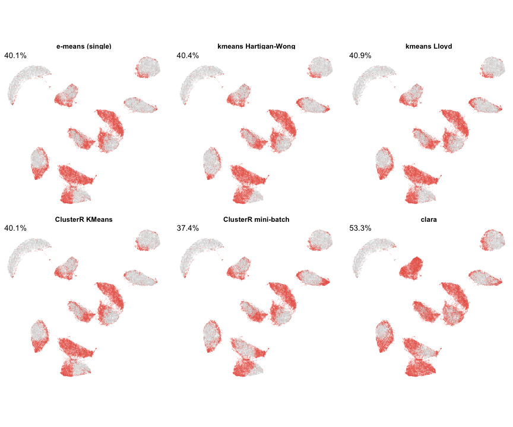


`emeans()` places 40.1% of the images in a cluster of another digit, Hartigan-Wong 40.4% and `clara()` 53.3%. Almost every 1 lands in a cluster of 1s, while the 4, 7 and 9 group and the 3, 5 and 8 group, which also touch on the UMAP, carry most of the red.

### A hundred clusters

With `k = 100`, `emeans()` cuts every digit into several clusters. The labels mark the median UMAP position of each cluster and its majority digit.


<details><summary>Show code</summary>

``` r
fit100 <- bench |>
  filter(variant == "e-means (single)", n == 70000, k == 100, seed == 1) |>
  pull(fit_id)
cl100 <- read_labels(fit100)
maj100 <- majority(cl100) |> arrange(cluster)
um100 <- um |>
  mutate(cluster = cl100) |>
  left_join(majority(cl100), by = "cluster") |>
  mutate(major = factor(major, 0:9))
c100 <- um100 |>
  group_by(cluster, major) |>
  summarise(across(c(u1, u2), median), size = n(), .groups = "drop")
ggplot(um100, aes(u1, u2, colour = major)) +
  geom_point(size = 0.03, alpha = 0.25, shape = 16) +
  geom_point(data = c100, aes(size = size), shape = 21, fill = "white", colour = "grey20") +
  geom_text(data = c100, aes(label = major), size = 2.3, colour = "grey10") +
  scale_colour_manual(values = pal_digit, guide = "none") +
  scale_size_area(max_size = 5, guide = "none") +
  coord_equal() +
  theme_void()
```


</details>

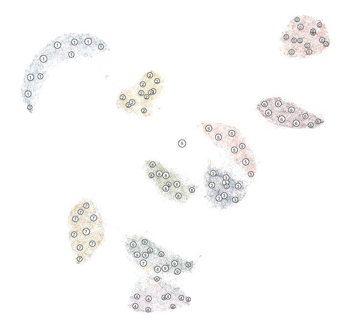

### A thousand clusters

At `k = 1000` the cluster centres cover the embedding. Each point is the median UMAP position of one cluster, sized by the number of images in it.


<details><summary>Show code</summary>

``` r
k1000 <- bench |>
  filter(n == 70000, k == 1000, seed == 1, status == "ok",
         variant %in% c("e-means (single)", "kmeans Hartigan-Wong", "ClusterR mini-batch")) |>
  select(variant, fit_id) |>
  mutate(centres = map(fit_id, \(f) {
    um |>
      mutate(cluster = read_labels(f)) |>
      group_by(cluster) |>
      summarise(across(c(u1, u2), median), size = n(),
                major = names(which.max(table(digit))))
  })) |>
  select(-fit_id) |>
  unnest(centres)
ggplot(k1000, aes(u1, u2, colour = factor(major, 0:9), size = size)) +
  geom_point(data = um, aes(u1, u2), inherit.aes = FALSE, size = 0.02, colour = "grey90") +
  geom_point(alpha = 0.7) +
  facet_wrap(~variant) +
  scale_colour_manual(values = pal_digit, guide = "none") +
  scale_size_area(max_size = 2.5, guide = "none") +
  coord_equal() +
  theme_void() +
  theme(strip.text = element_text(face = "bold"))
```


</details>

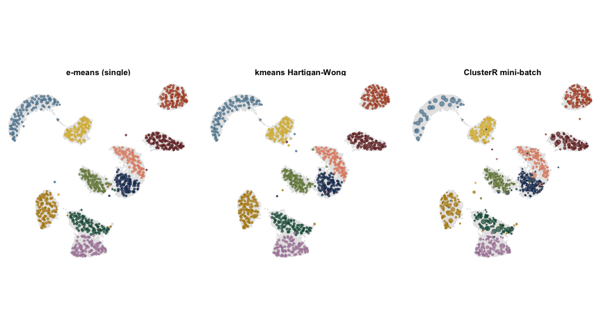


<details><summary>Show code</summary>

``` r
ggplot(k1000, aes(size, colour = variant)) +
  stat_ecdf(linewidth = 0.7) +
  scale_x_log10() +
  scale_colour_manual(values = pal_method) +
  labs(x = "Images per cluster (log scale)", y = "Share of clusters", colour = NULL)
```


</details>

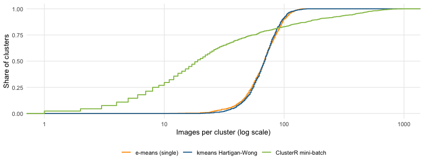

## Centroids as images

A centroid in pixel space is itself an image. These are the centres each method returned for `k = 10` on all images (medoids for `clara()`), next to the mean image of each true digit. The clusters are ordered by their majority digit.


<details><summary>Show code</summary>

``` r
centroid_runs <- bench |>
  filter(n == 70000, k == 10, seed == 1, status == "ok",
         variant %in% c("e-means (single)", "kmeans Hartigan-Wong", "ClusterR mini-batch", "clara")) |>
  arrange(variant) |>
  select(variant, run_id, fit_id)
digit_means <- rowsum(mnist$x, digit) / as.vector(table(digit))
centre_tiles <- centroid_runs |>
  mutate(tiles = map2(run_id, fit_id, \(r, f) {
    own <- read_centers(r)$own
    maj <- majority(read_labels(f)) |> arrange(cluster)
    ord <- order(maj$major, maj$cluster)
    digit_tiles(own[ord, ], seq_along(ord)) |> mutate(major = maj$major[ord][id])
  })) |>
  select(variant, tiles) |>
  unnest(tiles) |>
  mutate(variant = as.character(variant))
truth_tiles <- digit_tiles(digit_means, 1:10) |>
  mutate(variant = "Digit means", major = id - 1L)
bind_rows(truth_tiles, centre_tiles) |>
  mutate(variant = fct_inorder(variant)) |>
  ggplot(aes(col, -row, fill = value)) +
  geom_raster() +
  facet_grid(variant ~ id, switch = "y") +
  geom_text(aes(x = 2, y = -2, label = major), data = \(d) distinct(d, variant, id, major),
            inherit.aes = FALSE, size = 2.6, colour = "grey40", hjust = 0, vjust = 1) +
  scale_fill_gradientn(colours = met.brewer("Tam", direction = -1)) +
  coord_equal() +
  theme_void() +
  theme(legend.position = "none", strip.text.x = element_blank(),
        strip.text.y.left = element_text(angle = 0, hjust = 1, face = "bold"),
        plot.margin = margin(5, 5, 5, 20))
```


</details>

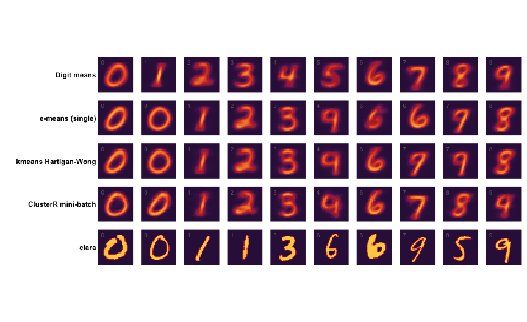

With `k = 100`, each digit gets between 8 and 13 of the `emeans()` centroids. Within a digit they differ in slant and stroke width, and the 2s split into looped and plain forms:


<details><summary>Show code</summary>

``` r
run100 <- bench |>
  filter(variant == "e-means (single)", n == 70000, k == 100, seed == 1) |>
  pull(run_id)
own100 <- read_centers(run100)$own
ord100 <- order(maj100$major, maj100$cluster)
digit_tiles(own100[ord100, ], seq_along(ord100)) |>
  mutate(major = maj100$major[ord100][id]) |>
  ggplot(aes(col, -row, fill = value)) +
  geom_raster() +
  facet_wrap(~id, ncol = 10) +
  scale_fill_gradientn(colours = met.brewer("Tam", direction = -1)) +
  coord_equal() +
  theme_void() +
  theme(legend.position = "none", strip.text = element_blank(),
        panel.border = element_rect(fill = NA, colour = "grey85"))
```


</details>

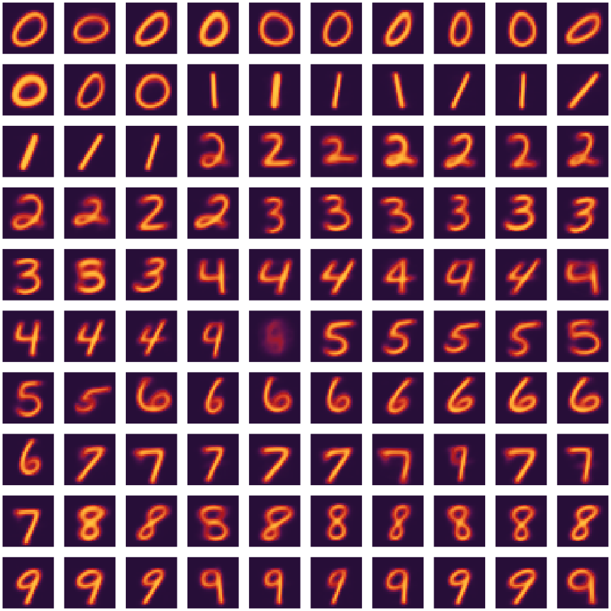


Table: Clusters per majority digit, e-means, k = 100

|  0|  1|  2|  3|  4|  5|  6|  7|  8|  9|
|--:|--:|--:|--:|--:|--:|--:|--:|--:|--:|
| 13| 10| 11|  9| 11|  8|  9| 10|  9| 10|


## Comparing the clusters between methods

### Clusters against digits

Each row is one cluster from the `k = 10` fits on all images, and each tile the share of its images that show a given digit.


<details><summary>Show code</summary>

``` r
k10_fits |>
  filter(variant %in% c("e-means (single)", "kmeans Hartigan-Wong", "ClusterR mini-batch", "clara")) |>
  mutate(tab = map(fit_id, \(f) {
    cl <- read_labels(f)
    maj <- majority(cl)
    tibble(cluster = cl, digit = digit) |>
      count(cluster, digit) |>
      mutate(share = n / sum(n), .by = cluster) |>
      left_join(maj, by = "cluster") |>
      mutate(row = paste(major, cluster))
  })) |>
  select(variant, tab) |>
  unnest(tab) |>
  mutate(row = fct_reorder(row, major + cluster / 100, .desc = TRUE)) |>
  ggplot(aes(factor(digit), row, fill = share)) +
  geom_tile(colour = "white") +
  facet_wrap(~variant, scales = "free_y", nrow = 1) +
  scale_fill_gradientn(colours = met.brewer("Hokusai2"), labels = label_percent()) +
  scale_y_discrete(labels = \(x) sub(" .*", "", x)) +
  labs(x = "True digit", y = "Cluster (by majority digit)", fill = "Share of cluster") +
  theme(panel.grid = element_blank())
```


</details>

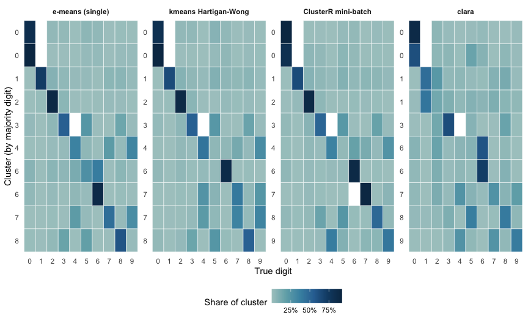


<details><summary>Show code</summary>

``` r
# Share of each digit's images that land in a cluster whose majority is that digit.
k10 |>
  group_by(variant, digit) |>
  summarise(recall = mean(!wrong), .groups = "drop") |>
  ggplot(aes(digit, recall, colour = variant)) +
  geom_point(size = 2.5, alpha = 0.9, position = position_dodge(width = 0.7)) +
  scale_y_continuous(labels = label_percent(), limits = c(0, 1)) +
  scale_colour_manual(values = pal_method) +
  labs(x = "Digit", y = "Images in a cluster with\ntheir digit as majority", colour = NULL,
       title = "k = 10, 70,000 images, seed 1") +
  guides(colour = guide_legend(nrow = 2))
```


</details>

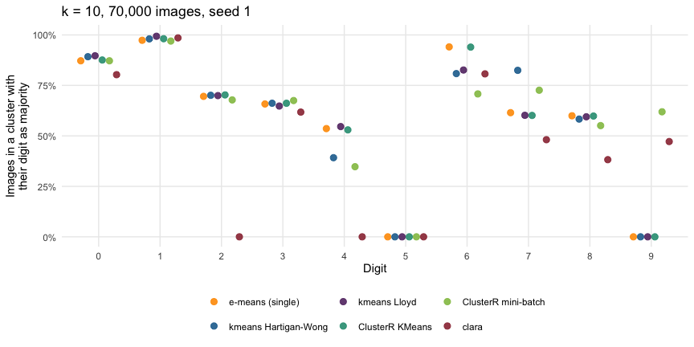

### e-means against Hartigan-Wong

Cross-tabulating the two `k = 10` partitions shows which clusters the two methods share and where they split the data differently.


<details><summary>Show code</summary>

``` r
lab_em <- read_labels(k10_fits$fit_id[k10_fits$variant == "e-means (single)"])
lab_hw <- read_labels(k10_fits$fit_id[k10_fits$variant == "kmeans Hartigan-Wong"])
name_by_major <- function(cl) {
  majority(cl) |>
    arrange(major, cluster) |>
    mutate(name = paste0(major, letters[row_number()]), .by = major) |>
    mutate(name = if (n() == 1) as.character(major) else name, .by = major) |>
    select(cluster, name)
}
nm_em <- name_by_major(lab_em)
nm_hw <- name_by_major(lab_hw)
tibble(em = lab_em, hw = lab_hw) |>
  count(em, hw) |>
  left_join(rename(nm_em, em = cluster, em_name = name), by = "em") |>
  left_join(rename(nm_hw, hw = cluster, hw_name = name), by = "hw") |>
  ggplot(aes(hw_name, fct_rev(em_name), fill = n)) +
  geom_tile(colour = "white") +
  geom_text(aes(label = if_else(n >= 500, label_comma()(n), "")), size = 2.6, colour = "white") +
  scale_fill_gradientn(colours = met.brewer("Hokusai2"), transform = "log10",
                       labels = label_comma()) +
  labs(x = "kmeans Hartigan-Wong cluster", y = "e-means cluster", fill = "Images",
       caption = "Clusters named by majority digit; a, b mark a digit split in two.") +
  theme(panel.grid = element_blank(), legend.position = "right")
```


</details>

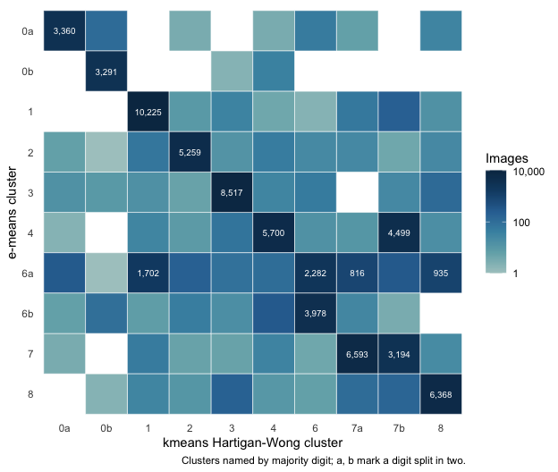

The ARI between the two partitions is 0.686.

### All methods

Pairwise adjusted Rand index between every method's `k = 10` partition (seed 1), with the true digits as one more row. On the left all 70,000 images; on the right 10,000 images, where the Ward methods and `Mclust()` finished too.


<details><summary>Show code</summary>

``` r
ari_matrix <- function(nn) {
  fits <- bench |>
    filter(n == nn, k == 10, seed == 1, status == "ok") |>
    arrange(variant) |>
    select(variant, fit_id)
  labs <- c(list(`True digit` = digit[subsets[[as.character(nn)]]]),
            set_names(map(fits$fit_id, read_labels), as.character(fits$variant)))
  expand_grid(a = names(labs), b = names(labs)) |>
    mutate(ari = map2_dbl(a, b, \(x, y) ARI(labs[[x]], labs[[y]])),
           a = factor(a, names(labs)), b = factor(b, rev(names(labs))))
}
plot_ari <- function(d, title) {
  ggplot(d, aes(a, b, fill = ari)) +
    geom_tile(colour = "white") +
    geom_text(aes(label = label_number(0.01)(ari)), size = 2.4) +
    scale_fill_gradientn(colours = met.brewer("Hokusai2"), limits = c(0, 1)) +
    labs(x = NULL, y = NULL, fill = "ARI", title = title) +
    coord_equal() +
    theme(axis.text.x = element_text(angle = 45, hjust = 1), panel.grid = element_blank())
}
plot_ari(ari_matrix(70000), "70,000 images") + plot_ari(ari_matrix(10000), "10,000 images") +
  plot_layout(guides = "collect")
```


</details>

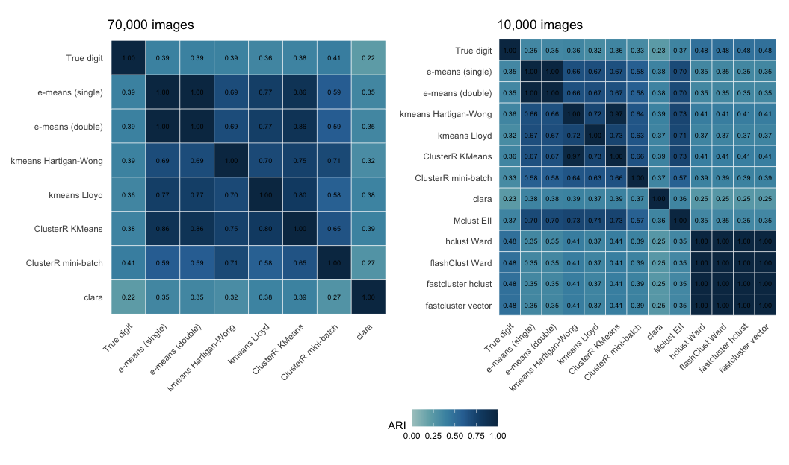

### The four Ward implementations

`stats::hclust()`, `flashClust::flashClust()`, `fastcluster::hclust()` and `fastcluster::hclust.vector()` all compute Ward's method. Cut at the same `k`, they return the same partition wherever more than one finished:


|Method             | Fits compared| Identical to hclust| Lowest ARI|
|:------------------|-------------:|-------------------:|----------:|
|flashClust Ward    |            12|                  12|          1|
|fastcluster hclust |            12|                  12|          1|
|fastcluster vector |             6|                   6|          1|


## Caveats

- The timings come from one laptop (Apple M2, 16 GB) and one run per seed. The efficiency cores are slower; runs were serial, but the operating system decides which core a process lands on.
- Every method ran on one thread. `emeans()`, `ClusterR` and BLAS-backed code can use more, and these runs do not show how the gaps change with more threads.
- Peak memory counts the whole R process above its size after loading the data, including copies of the input made by each method.
- The ARI against digits says little for `k` above 10. The inertia is what the k-means methods minimise and what Ward's merges approximate; `clara()` minimises unsquared distances to medoids instead.
- `Mclust()` was only run for `k = 10` up to 10,000 images: it took 599 seconds there.
- The UMAP layout is a picture of PCA-50 neighbourhoods. Distances on it do not equal distances in pixel space.

## References

Arthur, D. and Vassilvitskii, S. (2007). k-means++: the advantages of careful seeding. *Proceedings of the Eighteenth Annual ACM-SIAM Symposium on Discrete Algorithms*, 1027–1035.

Bessa, S., Mazaré, P.-E., Szilvasy, G., Touvron, H., Picard, D., Douze, M. and Jégou, H. (2026). e-means: outperforming k-means (in one-tenth the epochs). *arXiv*:2611.09501. <https://doi.org/10.48550/arXiv.2611.09501>

Hartigan, J. A. and Wong, M. A. (1979). Algorithm AS 136: a k-means clustering algorithm. *Applied Statistics*, 28(1), 100–108. <https://doi.org/10.2307/2346830>

Hubert, L. and Arabie, P. (1985). Comparing partitions. *Journal of Classification*, 2(1), 193–218. <https://doi.org/10.1007/BF01908075>

Kaufman, L. and Rousseeuw, P. J. (1990). *Finding Groups in Data: An Introduction to Cluster Analysis*. Wiley.

Langfelder, P. and Horvath, S. (2012). Fast R functions for robust correlations and hierarchical clustering. *Journal of Statistical Software*, 46(11). <https://doi.org/10.18637/jss.v046.i11>

LeCun, Y., Bottou, L., Bengio, Y. and Haffner, P. (1998). Gradient-based learning applied to document recognition. *Proceedings of the IEEE*, 86(11), 2278–2324. <https://doi.org/10.1109/5.726791>. Data used here: the Hugging Face copy <https://huggingface.co/datasets/ylecun/mnist>.

Lloyd, S. (1982). Least squares quantization in PCM. *IEEE Transactions on Information Theory*, 28(2), 129–137. <https://doi.org/10.1109/TIT.1982.1056489>

McInnes, L., Healy, J. and Melville, J. (2018). UMAP: uniform manifold approximation and projection for dimension reduction. *arXiv*:1802.03426. <https://doi.org/10.48550/arXiv.1802.03426>

Müllner, D. (2013). fastcluster: fast hierarchical, agglomerative clustering routines for R and Python. *Journal of Statistical Software*, 53(9). <https://doi.org/10.18637/jss.v053.i09>

Murtagh, F. and Legendre, P. (2014). Ward's hierarchical agglomerative clustering method: which algorithms implement Ward's criterion? *Journal of Classification*, 31(3), 274–295. <https://doi.org/10.1007/s00357-014-9161-z>

Sculley, D. (2010). Web-scale k-means clustering. *Proceedings of the 19th International Conference on World Wide Web*, 1177–1178. <https://doi.org/10.1145/1772690.1772862>

Scrucca, L., Fop, M., Murphy, T. B. and Raftery, A. E. (2016). mclust 5: clustering, classification and density estimation using Gaussian finite mixture models. *The R Journal*, 8(1), 289–317. <https://doi.org/10.32614/RJ-2016-021>

Vinh, N. X., Epps, J. and Bailey, J. (2010). Information theoretic measures for clusterings comparison: variants, properties, normalization and correction for chance. *Journal of Machine Learning Research*, 11, 2837–2854.

Ward, J. H. (1963). Hierarchical grouping to optimize an objective function. *Journal of the American Statistical Association*, 58(301), 236–244. <https://doi.org/10.1080/01621459.1963.10500845>

## Session info

The session that knitted this article (the benchmark versions are in the setup table above):


```
#> ─ Session info ───────────────────────────────────────────────────────────────
#>  setting  value
#>  version  R version 4.6.1 (2026-06-24)
#>  os       macOS Golden Gate 27.2.1
#>  system   aarch64, darwin23
#>  ui       X11
#>  language (EN)
#>  collate  C.UTF-8
#>  ctype    C.UTF-8
#>  tz       Europe/London
#>  date     2026-11-15
#>  pandoc   3.13 @ /opt/homebrew/bin/pandoc
#>  quarto   1.11.9 @ /usr/local/bin/quarto
#> 
#> ─ Packages ───────────────────────────────────────────────────────────────────
#>  package   * version date (UTC) lib source
#>  aricode   * 1.1.0   2026-05-13 [1] CRAN (R 4.6.0)
#>  dplyr     * 1.2.1   2026-04-03 [1] CRAN (R 4.6.0)
#>  forcats   * 1.0.1   2025-09-25 [1] CRAN (R 4.6.0)
#>  ggplot2   * 4.0.4   2026-11-14 [1] CRAN (R 4.6.1)
#>  ggrepel   * 0.9.8   2026-03-17 [1] CRAN (R 4.6.0)
#>  lubridate * 1.9.5   2026-02-04 [1] CRAN (R 4.6.0)
#>  MetBrewer * 0.2.0   2022-03-21 [1] CRAN (R 4.6.0)
#>  patchwork * 1.3.2   2025-08-25 [1] CRAN (R 4.6.0)
#>  purrr     * 1.2.2   2026-04-10 [1] CRAN (R 4.6.0)
#>  readr     * 2.2.0   2026-02-19 [1] CRAN (R 4.6.0)
#>  scales    * 1.4.0   2025-04-24 [1] CRAN (R 4.6.0)
#>  stringr   * 1.6.0   2025-11-04 [1] CRAN (R 4.6.0)
#>  tibble    * 3.3.1   2026-01-11 [1] CRAN (R 4.6.0)
#>  tidyr     * 1.3.2   2025-12-19 [1] CRAN (R 4.6.0)
#>  tidyverse * 2.0.0   2023-02-22 [1] CRAN (R 4.6.0)
#> 
#>  [1] /Library/Frameworks/R.framework/Versions/4.6/Resources/library
#>  * ── Packages attached to the search path.
#> 
#> ──────────────────────────────────────────────────────────────────────────────
```
